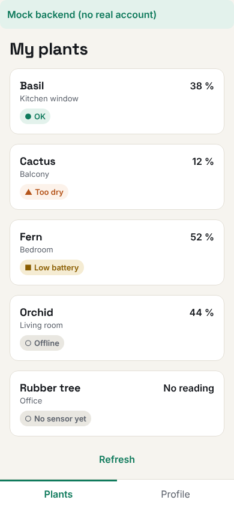
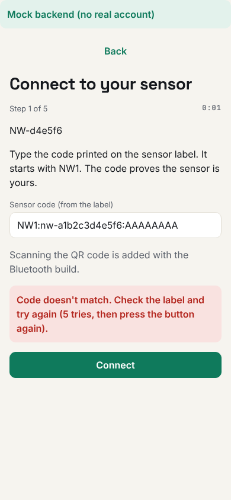
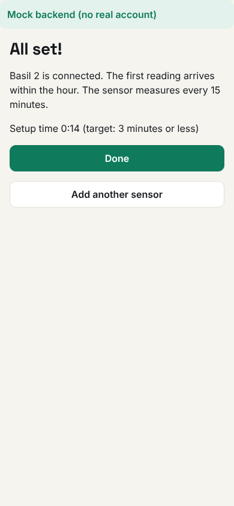
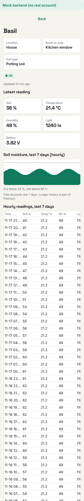
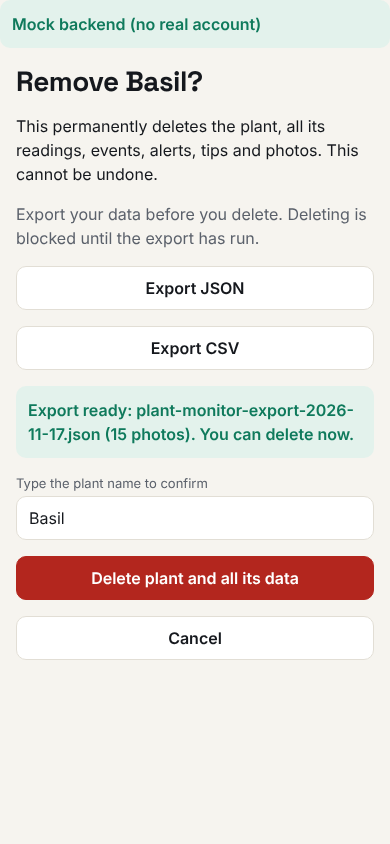

# Try the Plant Monitor app (what works today, what does not)

For Arsany, Peter and new joiners. Written 2026-11-17 by Leo (task 4.A10) against `main` after PR #123. Every step below was run in a headless Chrome (390 x 844 px, the mock build) on 2026-11-17, and the "expected" text is what the page showed. Nothing here was run on a phone or against the live backend.

**Short version:** you can click through the whole app in a browser against an in-memory fake backend. You still cannot connect the app to a real sensor today: the real Bluetooth code now exists (4.A3b slice 1) but has never run on a phone (section 4).



## 1. Quick start (5 minutes, no account, no network)

1. Install Node 22 (the version used for this guide was 22.23). No phone, no Expo account.
2. From the repo root:
   ```bash
   cd projects/plant-monitor/app
   npm ci
   EXPO_PUBLIC_MOCK_AUTH=1 npx expo start --web
   ```
3. Open the URL it prints (default `http://localhost:8081`) in Chrome. The first load takes a while while Metro bundles. Use the browser's phone view (DevTools, device toolbar, 390 px wide) so it looks like the phone.
4. A green bar at the top says "Mock backend (no real account)". If you do not see it, you are not in mock mode.

Things to know about the mock:
- Everything lives in memory. **Reloading the page erases accounts, removed plants and setup state.** Sign up again after a reload.
- The five plants, readings and photos are made-up fixture data (wireframe S20), not measurements.
- Any e-mail with a valid shape works (`you@example.com`), password at least 8 characters. No e-mail is sent.

### Expo Go, dev build, web: which one?

| Way to run | Works today? | Notes |
|---|---|---|
| **Web** (`expo start --web`) | Yes, verified for this guide | The path for everything in section 2. |
| **Expo Go** on a phone (`npx expo start`, scan QR) | Not tried | The mock screens may run there, but no one has checked. Expo Go cannot do Bluetooth provisioning, so it can never be the way to test a real sensor. |
| **Dev build** (a custom Expo app with native modules) | Configured (4.A3b slice 1), **never built** | Needed for Bluetooth setup. `expo-dev-client` and `@orbital-systems/react-native-esp-idf-provisioning@0.7.1` are in `package.json` and `app.config.ts`; `expo prebuild` runs. Nobody has compiled or installed it yet (needs Android Studio/Xcode or EAS). |

The real Bluetooth service (`ProvisioningService`, `src/provisioning/bleProvisioning.ts`) is **now written and unit-tested against mocks, but never run with Bluetooth or a sensor**. It is used only in a dev build (not web, not Expo Go, Supabase configured). In Expo Go or the web without `EXPO_PUBLIC_MOCK_AUTH=1`, "Find my sensor" still shows "Sensor setup needs the full app build because it uses Bluetooth. It is not available in this preview." (`setup.error.not_available`).

## 2. Click-by-click walkthrough (mock build)

Labels are the exact button and field text. Start on the Welcome screen after a fresh load.

### 2.1 Sign up, sign in, profile (FR-A01)
1. **Create account**. Type `bad` as e-mail and `short` as password, press **Create account**. Expected: "Enter a valid e-mail, for example you@example.com." and "Use at least 8 characters."
2. Use `leo@example.com` / `correct-horse-1` (display name optional), **Create account**. Expected: you land on "My plants" with five plants (2.3).
3. Tap **Profile** (bottom tab). Expected: your e-mail, Plan "Free", a "What is Premium?" link, display name field, **Add a sensor**, **Sign out**, **Delete account**, and a legal line with the contact address.
4. Change the display name, **Save name**. Expected: "Name saved."
5. **Sign out**, then **I already have an account**. Try a wrong password. Expected: "E-mail or password is not right." Then the right one: you are back on "My plants".
6. Quirk (known, not a bug in the flow): the Profile screen still says "Your plant list is added in a later version." although the plant tab exists. Premium sheet ("What is Premium?") says Premium is activated by Nilwerk and shows a "Contact us" mail link.

### 2.2 Add a sensor, fake provisioning (FR-A03, FR-D03, FR-A04, FR-A05, FR-A02)
No Bluetooth is used. A fake sensor exists with the label code below.



1. Profile -> **Add a sensor**. Expected: "Step 1 of 5" and a running timer (0:00, counts up each second). Text about pressing the pinhole button.
2. **Find my sensor**. Expected after about a second: "Found nearby" and one button **NW-d4e5f6**. Tap it.
3. "Connect to your sensor" asks for the label code. The code of the fake sensor is
   `NW1:nw-a1b2c3d4e5f6:7KQ2M9XD` (case and spaces are forgiven when typing).
   - Type `hello`, **Connect**: "That does not look like a sensor code. Example: NW1:nw-a1b2c3d4e5f6:7KQ2M9XD" (nothing counted against the 5 tries).
   - Right shape, other sensor, e.g. `NW1:nw-111111111111:7KQ2M9XD`: "That code belongs to a different sensor than NW-d4e5f6." (also not counted).
   - Right sensor, wrong secret, e.g. `NW1:nw-a1b2c3d4e5f6:AAAAAAAA`: "Code doesn't match. Check the label and try again (5 tries, then press the button again)."
   - **Fifth wrong secret in a row:** "Setup mode closed. Press the pinhole button on the sensor again, then start over." In the mock the sensor then stays closed until you reload the page (a scan finds nothing). A real sensor reopens with the pinhole button (contract: [`ble-provisioning.md`](../docs/interfaces/ble-provisioning.md)).
   - The correct code moves on.
4. **Wi-Fi step** (Step 2 of 5): the list shows `HomeNet-2G` and `Neighbour_5G`, plus "Other network...". The only combination that works is `HomeNet-2G` with password `correct-horse`. Anything else is a failure in step 6 below. The password field needs 8 to 63 characters, otherwise "A Wi-Fi password has 8 to 63 characters." **Continue**.
5. **Name your sensor** (Step 3 of 5): type e.g. `Basil on the sill`, **Connect sensor**. Empty name: "Give the sensor a name."
6. "Connecting" shows "Joining Wi-Fi..." then "Linking to your account..." (about 2 seconds in total).
   - Wrong Wi-Fi password: "Wi-Fi didn't work", "The sensor couldn't join HomeNet-2G. Wrong password?" with **Re-enter password** and **Choose another network**. (Tested: re-entering `correct-horse` and pressing Continue, name, Connect sensor goes through.)
   - A network name that is not in the list ("Other network...") gives "The sensor couldn't find <name>. Move it closer to the router. Only 2.4 GHz networks work."
   - The "sensor already belongs to someone" and "server could not link" screens exist but cannot be triggered by hand in the web mock (only by the tests).
7. **Photo** (Step 4 of 5): **Take photo**, **Choose from library** or **Skip for now**. In the mock both photo buttons return a fake file name; no camera opens.
8. **About your plant** (Step 5 of 5): press **Save plant** empty to see the three errors ("Enter the plant name.", "Enter a room or area.", "Enter a city."). Fill plant name, room, city (location type and soil type have defaults), **Save plant**.
9. "All set!" shows "<name> is connected. The first reading arrives within the hour. The sensor measures every 15 minutes." and "Setup time 0:14 (target: 3 minutes or less)" (our run took 14 seconds because a script typed it; a person will be slower). **Done** returns to Profile, **Add another sensor** restarts the flow.



**Known limit of the mock:** the plant you just created is stored in a separate fake service and does **not** appear in the plant list (the list always shows the 5 fixture plants). That wiring only exists in the real app. The time shown is not test 5.5 (the real-phone setup-time test).

### 2.3 Plant list and status chips (FR-A06)
Tap **Plants**. Expected, five rows with soil moisture and a chip (shape + word + colour, never colour alone):

| Plant | Area | Soil | Chip |
|---|---|---|---|
| Basil | Kitchen window | 38 % | OK |
| Cactus | Balcony | 12 % | Too dry |
| Fern | Bedroom | 52 % | Low battery |
| Orchid | Living room | 44 % | Offline |
| Rubber tree | Office | No reading | No sensor yet |

**Refresh** reloads the list (there is no pull-to-refresh yet).

### 2.4 Plant detail, 7-day chart, hourly table (FR-A06, FR-D02)
Tap **Basil**. Expected, top to bottom: location / room / soil type, the chip, "Updated 14 min ago", "Latest reading" tiles (Soil 38 %, Temperature 21.4 C, Humidity 48 %, Light 1240 lx, Battery 3.82 V), the chart "Soil moisture, last 7 days (hourly)" with a dashed dry and wet threshold line (dry below 25 %, wet above 85 %), then "Hourly readings, last 7 days": a table of 168 hourly rows, newest first, columns Time, Soil %, Temp, RH, Light, Battery. An hour with no report shows a dash. Open **Orchid** to see the five newest hours as dashes (the fixture sensor is "offline"). **Rubber tree** has no sensor: "No readings in the last 7 days." Note the "Latest reading" numbers are fixture values, not derived from the chart. On a narrow screen the table scrolls sideways.



### 2.5 Photo gallery (FR-A05)
On Basil press **Photos**. Expected: "12 photos" (Fern has 3, the others none: "No photos yet"), dated tiles, **Newest first** / **Oldest first** toggles. Mock photos have no pictures, only the date. There is no upload ("+ Add") yet.

### 2.6 Remove a plant, export first (FR-A08, A-022, NFR-07)
Basil -> **Remove plant**. Expected: "Remove Basil?" with the permanent-delete warning, **Export JSON**, **Export CSV**, a field "Type the plant name to confirm", and "Export first. The delete button unlocks after the export."
- **Delete plant and all its data** is disabled. Type `Basil`: still disabled (no export yet).
- **Export JSON**: "Export ready: plant-monitor-export-2026-11-17.zip (your data and 15 photos). You can delete now." (4.A9b: in a real build the archive holds `export.json` and every photo; **Export CSV** only saves the tables and keeps delete locked) (the count is all photos of the account, because the export has no plant filter). The mock only pretends: no file is downloaded.
- Now the button is enabled (name typed exactly, no skip option by owner decision A-106). Press it: "Basil was removed", "Your sensor NW-d4e5f6 is still linked to your account." with **Keep sensor** and **Release sensor** (Release unlinks it, mock only). Keep sensor: the list now has four plants.



### 2.7 Delete account gate (NFR-07, FR-A01)
Profile -> **Delete account**. Expected: warning text, **Export as JSON**, **Export as CSV**, field "Type DELETE to confirm", and "Export first...". Check the gate:
- **Delete everything** is disabled before an export, even with `DELETE` typed.
- After **Export as CSV**: "...The CSV lists your photos but does not contain them, so delete stays locked." Delete is still disabled. After **Export as JSON**: "Export ready: plant-monitor-export-2026-11-17.zip (your data and 3 photos). You can delete now." (the count follows what is left: the 12 Basil photos were removed in 2.6).
- Typing `delete` in lower case keeps it disabled; `DELETE` enables it.
- **Delete everything**: back to Welcome. Signing in with the same e-mail now says "E-mail or password is not right." (the account is gone). Real behaviour differs: see section 3.

## 3. Against the real backend

Set before `expo start` (names only; values come from Arsany and are never committed, see [`README.md`](README.md)):
`SUPABASE_URL`, `SUPABASE_PUBLISHABLE_KEY` (the `sb_publishable_...` key, never a secret or service-role key), optional `CONTACT_EMAIL`. Do not set `EXPO_PUBLIC_MOCK_AUTH`. Without both Supabase values the app shows "The app is not connected to a server yet."

| Area | Status today | Evidence |
|---|---|---|
| Sign up / sign in / sign out / profile | **UNVERIFIED**, expected to work: real `supabase-js` client (`src/auth/supabaseAuth.ts`) against project `nilwerk-cloud` | Never run on a phone or against the live project from the app; only unit tests with fakes. If the project requires e-mail confirmation, sign up shows "Almost done. We sent a confirmation link to <e-mail>. Open it, then sign in." |
| Edge functions deployed on `nilwerk-cloud` | `claim-token`, `device-claim`, `ingest`, `delete-account` | [`../cloud/README.md`](../cloud/README.md); not exercised from the app on a phone |
| Plant list, detail, gallery | **Not working.** In a real build only `exportData` is real; list, detail, photos and delete-plant are not wired (see the header of `realPlants.ts`), so the plant screens show an error | `App.tsx`, `src/plants/` (`realPlants.ts` has export only) |
| Delete account | The call exists (`DELETE /functions/v1/delete-account`) but the gate needs an export first, and the export cannot succeed (next row). **Delete stays blocked.** | `src/account/accountApi.ts`, `src/export/exportGate.ts` |
| Export (JSON / CSV) | **Fails against the live project.** The client is built (4.A9) and now also downloads the photos into the archive (4.A9b, A-107), but the `export` edge function is not deployed (4.B2c, PR #130) | README "4.A2 follow-up" |
| Real sensor connection | **No.** Real BLE client written and mock-tested (4.A3b slice 1), never run on a phone or sensor | section 4 |
| Real plant data from a device | **No.** v1 bench firmware only prints to the serial console; upload is not wired | [`../v1/FIRMWARE-BENCH.md`](../v1/FIRMWARE-BENCH.md) |
| Push alerts | Not built (alerts screens are task 4.A5; no push dispatch in the cloud) | `App.tsx` header, cloud README |
| Premium dashboard (30 / 90-day history, trends) | Not built. The Premium sheet is text only; Premium is switched on by Nilwerk by hand (`profiles.is_premium`) | `PremiumScreen`, FR-P04 |
| Care tips UI | Not built (the tips engine in `cloud/tips/` is a library, no screen, no endpoint) | cloud README |
| MCP / AI access screens | Not built (no screen; MCP server is task 4.B5) | `docs/interfaces/mcp-tools.json` |

## 4. Can we connect the app to the sensor today?

**No.** The app side now has real Bluetooth code (4.A3b slice 1, unit-tested against mocks only), but nothing has run on a phone or sensor. Five pieces are still missing:

| Gap | Where it is today | Task that closes it | State |
|---|---|---|---|
| App side, done as code in slice 1 (PR for 4.A3b): real BLE `ProvisioningService` (scan `NW-*` + service UUID, connect with the label code, Wi-Fi, claim token, `nw-status`, error mapping), `expo-dev-client` + BLE config plugin, wired in `App.tsx` for non-mock phone builds | `bleProvisioning.ts`, `espAdapter.ts`, `claimApi.ts`; 261 Jest tests green with a mocked library; `expo prebuild` produces the Bluetooth permissions. **Never compiled as a native app, never run with Bluetooth**; library built for RN 0.84, app is on 0.88 (UNVERIFIED) | 4.A3b slice 1 | code done, not run |
| App side, still missing: a dev build on a real phone, QR scanning and camera/library (`expo-image-picker`), the real `PlantSetupService` (in a real build plant details and photo are still in-memory fakes and are not saved), the SRP user name agreed with firmware (app uses `wifiprov`, UNVERIFIED) | none of it exists yet | 4.A3b slices 2+ | not started |
| Sensor side: the setup flow switched on in firmware | The v1 bench build sets `CONFIG_PLANT_SETUP_FLOW=n` (BLE setup flow off). With it on, a never-provisioned unit deep sleeps with no timer before reading any sensor | 4.F2b (firmware setup flow on, per-unit security-2 provisioning), Mira | off in v1 bench; nothing has run on hardware |
| Sensor side: the hourly upload adapter (real HTTP over TLS and Wi-Fi to `/ingest`, with the per-device token) | Upload logic is host-tested with a fake transport only; `PLANT_API_BASE_URL` stays `https://api.invalid` (A-082) | 4.F3 (firmware upload adapter, remaining slices) | slice 2 done on the host, no real transport |
| Cloud side: reading plant data in the app | Real plants service for list, detail, photos is missing; export function missing | 4.A4c (real `PlantsService`), 4.B2c (export edge function, Sana, in progress) | not started |

Until all rows are closed the honest status of "can a first-time user set up a sensor in three minutes?" (NFR-03) is **untestable**. Test 5.5 on a real phone is the check (**not done**); 4.A3 / 4.A3b are Done only after it.

## 5. What to try first (suggested order for a 15 minute session)
1. 1 + 2.1 (sign up, profile). 2. 2.3 and 2.4 (list, detail, chart, table). 3. 2.2 including the wrong code five times and the wrong Wi-Fi password. 4. 2.6 and 2.7 (the delete gates).

Questions worth answering while you click, because only a human can: Is the chart readable? Are the chip words clear? Would you know what to do on the "Setup mode closed" screen? Write the answers in the bug report below.

## 6. Reporting a bug

Open a GitHub issue (or send it to Nora) with:
1. **Where:** screen name and the step number from this guide (for example "2.2 step 6").
2. **How you ran it:** web mock or real backend; browser and version; window width; commit (`git rev-parse --short HEAD`); date and time.
3. **What you did:** exact text typed (never a real password; use throwaway ones), buttons pressed, in order.
4. **Expected vs got:** quote the text on the screen.
5. **A screenshot** of the whole screen, and for web the browser console (DevTools, Console tab: copy red lines) and the terminal output of `expo start`.
6. **Real backend only:** the time of the action (so the logs can be found), and **never** paste `SUPABASE_PUBLISHABLE_KEY` values, tokens, sensor labels of real units or personal data. Blur them.
7. Say if reloading the page fixed it (mock state is in memory).

## 7. Sources (all checked 2026-11-17)
[`README.md`](README.md) (run, config, known gaps) · [`App.tsx`](App.tsx) (which service is wired when) · [`src/provisioning/fakeProvisioning.ts`](src/provisioning/fakeProvisioning.ts) (fake sensor, 5 tries, Wi-Fi rules) · [`src/plants/fakePlants.ts`](src/plants/fakePlants.ts) (fixture) · [`strings/en.json`](strings/en.json) (every quoted text) · [`../cloud/README.md`](../cloud/README.md) · [`../v1/FIRMWARE-BENCH.md`](../v1/FIRMWARE-BENCH.md) · [`../docs/interfaces/ble-provisioning.md`](../docs/interfaces/ble-provisioning.md). Screenshots: real, from the web mock, in [`showcase/items/2026-11-17_4.A10-try-it/`](../../../showcase/items/2026-11-17_4.A10-try-it/).
