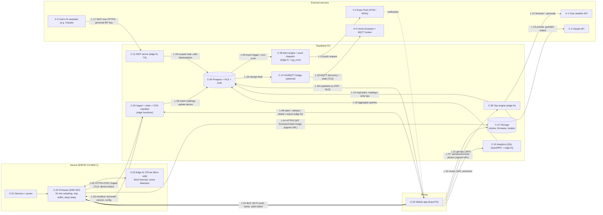

# Plant Monitor — System Architecture (task 2.1)

Status: **draft v0.1 for the G2 design review (Fri 2026-11-06)** · Author: Theo (System Architect) · Date: 2026-11-03
Synced with: Requirements v0.1 (Google Doc `1T4k3rK4KQDeGtIN8pjdmohGUAohFrtATLhMYSBsYA6g`) and Questions Q-01..Q-16.
Out of scope here: DB schema and API spec (task 2.4), risk register (2.8), cost model (2.6). Open points for those are in section 8.

## 1. Overview

A battery device (ESP32-C3-MINI-1) samples soil moisture, air temperature, air humidity, light and battery every 15 min with Wi-Fi off, runs two tiny int8 models on the device (thirst forecast, event/fault detection) and reports to a standalone cloud once per hour, or immediately on a critical event. The cloud is Supabase (EU): Postgres with RLS, Auth, Storage, Edge Functions. A React Native (Expo) app talks to Supabase directly under RLS for plain reads/writes and to edge functions for anything that needs server logic. Premium features (tips engine, analytics, MCP server) are edge functions that check a per-user flag server-side. An optional bridge publishes plant state to Home Assistant over MQTT.

## 2. Diagram

Text form of the data path: sensors -> firmware (15 min) -> AI features -> RAM/flash ring buffer -> hourly Wi-Fi wake -> `POST /ingest` (batch of samples + forecast + events) -> Postgres -> app (Realtime or pull) / alert engine -> push.

## 3. Components

Owner = role that builds it (TEAM.md §2); Theo reviews every PR. Requirement IDs are from Requirements v0.1.

| ID | Component | Owner | Responsibility | Traces to |
|---|---|---|---|---|
| C-01 | Sensors + power (moisture, AHT20, BH1750, battery ADC, USB-C charger, LED, pinhole button) | Emil (PCB), Mira (drivers) | Produce the five values, charging indication, reset input | FR-D01, FR-D06, FR-D07, NFR-01, NFR-02, NFR-08, NFR-09 |
| C-02 | Firmware (ESP-IDF 5.x, C): sampling, calibration, ring buffer, deep sleep, BLE provisioning, Wi-Fi/TLS client, OTA with rollback, factory reset | Mira | Everything on the device except the models | FR-D01..D07, FR-E03, NFR-01, NFR-06 |
| C-03 | Edge AI: model A (thirst forecast), model B (event/fault), feature extraction; int8, <30 KB flash, <20 KB RAM, <50 ms | Mira (models, ML under `ml/`), Sana (training infra) | Forecast + events computed on the device every 15 min | FR-E01..E04, FR-A07 (AI events), Q-16 |
| C-04 | Mobile app (Expo, TS, iOS + Android): auth, setup flow, plants, gallery, charts, alerts, premium screens, account export/delete | Leo | All user interaction; BLE client for setup | FR-A01..A08, FR-P01..P04 (UI), UC-01..UC-12, NFR-03, NFR-04 |
| C-05 | Ingest + claim + manifest edge functions | Leo (4.B1/4.B2), contract by Theo (2.4) | Authenticate device, validate and store reports, claim/release, hand out OTA manifest and config (thresholds) | FR-D02, FR-D03, FR-D04, FR-D05, FR-A02, FR-A08, NFR-04, NFR-06 |
| C-06 | Postgres + Auth + RLS (+ Realtime) | Leo | System of record; every table has RLS; premium flag per user | FR-A01, FR-A04, FR-P04, NFR-06, NFR-07 |
| C-07 | Storage (private buckets: photos, firmware, models) | Leo | Photos per plant, signed URLs; versioned firmware/model blobs | FR-A05, FR-D05, NFR-07 |
| C-08 | Alert engine + push dispatch | Leo (4.B6) | Too dry/wet, low battery, offline (missed reports), edge-AI events; dedupe so each alert fires once | FR-A07, FR-D06, FR-E03, NFR-04 |
| C-09 | Tips engine | Sana (4.B3) | Weather + season + plant + readings -> Claude -> output filtered by deterministic safety rules | FR-P02, FR-P04, Q-13 |
| C-10 | Analytics (30/90-day history, trends, watering events, compare) | Sana (4.B4) | SQL aggregations behind a premium check | FR-P01, FR-P04 |
| C-11 | MCP server (`list_plants`, `get_plant_status`, `get_history`, `get_tips`) | Sana (4.B5) | Personal API keys (hashed, revocable), read-only, premium-gated | FR-P03, FR-P04, NFR-06 |
| C-12 | HA/MQTT bridge (optional, "Could") | Leo (4.B7 if time) | Publish HA MQTT-discovery entities from cloud state to a user-supplied broker | FR-I01 |
| C-13 | CI/CD, OTA release pipeline, secrets | Kai | Build/sign firmware and model artefacts, deploy functions, migrations | FR-D05, NFR-06 |
| X-1..X-5 | External: weather API, Claude API, Expo Push, user's AI assistant, Home Assistant | — | Third-party; no secrets in repo | Q-13, FR-P03, FR-I01 |

## 4. Interfaces per link

Contracts are written in 2.4 (`docs/interfaces/`); this table fixes the style and the facts they must honour.

| Link | From -> To | Protocol / format | Auth | Contract (to be written in 2.4) | Traces to |
|---|---|---|---|---|---|
| L-01 | App -> device | BLE GATT via ESP-IDF `wifi_provisioning` (protocomm, security 1/2 with proof-of-possession printed on label/QR) + custom endpoint carrying name and claim token | PoP | `interfaces/ble-provisioning.md` | FR-D03, FR-A03, NFR-03 |
| L-02 | Device -> ingest | HTTPS POST, JSON, TLS 1.2+ with pinned CA | `Authorization: Bearer <device token>` | `interfaces/device-report.schema.json` + OpenAPI `/ingest` | FR-D01, FR-D02, FR-D04, NFR-06 |
| L-03 | Ingest -> device | HTTP response body | same call | `{server_time, fw_target, model_target, config{thresholds, sample_interval}}` | FR-D05 |
| L-04 | Device -> Storage | HTTPS GET, signed URL from manifest | URL expiry | firmware/model image + SHA-256 | FR-D05 |
| L-05 | Ingest -> DB | SQL (service role, inside edge function only) | service role secret | DB schema (2.4) | FR-D02, FR-E01 |
| L-06 | App -> DB | supabase-js, PostgREST + Realtime | user JWT, RLS | DB schema + RLS policies (2.4) | FR-A01..A06, NFR-06 |
| L-07 | App <-> Storage | HTTPS, signed URLs | user JWT | bucket policy | FR-A05 |
| L-08 | App -> edge fn | HTTPS JSON: claim, release, delete account, export, key mgmt | user JWT | OpenAPI | FR-A01, FR-A08, NFR-07 |
| L-09 | DB -> alert engine | insert trigger + pg_cron scan (offline detection) | internal | alert rules doc | FR-A07 |
| L-10 | Alert -> Expo Push | HTTPS | access token (secret) | payload with no sensitive data | FR-A07 |
| L-11 | App -> tips | HTTPS | user JWT + premium check | OpenAPI `/tips` | FR-P02 |
| L-12 | Tips -> weather | HTTPS REST | none/API key | provider adapter interface | FR-P02, Q-13 |
| L-13 | Tips -> Claude API | HTTPS, structured JSON output | API key in Supabase secret | prompt + output schema + rule list | FR-P02, Q-13 |
| L-14, L-16, L-18 | Edge fn -> DB | SQL | scoped role / RPC | schema | FR-P01..P03 |
| L-15 | App -> analytics | HTTPS | JWT + premium | OpenAPI `/analytics` | FR-P01 |
| L-17 | AI assistant -> MCP | MCP, Streamable HTTP | `Bearer <personal API key>` (hash stored, revocable) | `interfaces/mcp-tools.json` | FR-P03, NFR-06 |
| L-19/L-20 | Bridge -> HA | MQTT 3.1.1/5 over TLS, HA discovery topics | user broker credentials (encrypted) | `interfaces/ha-discovery.md` | FR-I01 |

## 5. Key flows

**Setup (UC-02, FR-D03, FR-A03).** App (authenticated) asks `claim` for a one-time claim token bound to the user (L-08). User powers device -> BLE advertises. App connects with PoP (L-01), sends Wi-Fi credentials, device name, claim token. Device joins Wi-Fi, calls `/ingest` with the claim token once; the function creates the device row, issues a per-device token (returned once, stored in NVS), and the claim token is consumed. App sees the device via Realtime. Plant details and first photo are saved by the app. Factory reset (FR-D07) wipes NVS (Wi-Fi + token); release (FR-A08) revokes the token server-side and clears `owner`.

**Reporting (FR-D01/D02/D04).** Every 15 min: wake, sample, calibrate to 0-100 % relative moisture, update features, run models, append to ring buffer in flash, sleep. Every 4th wake (or on critical event, FR-E03): Wi-Fi on, SNTP, POST all unsent samples with the latest forecast and event flags; delete only after HTTP 2xx. Without Wi-Fi the buffer keeps >= 24 h (96 samples) and is sent on reconnect; backoff avoids draining the battery.

**Alerts (FR-A07).** Ingest writes readings; a trigger evaluates thresholds from the plant (too dry/wet), battery threshold, and device event flags; a cron job marks a device offline after 2.5 missed hours. Each alert has a state row so it fires once until resolved. Push goes through Expo Push (L-10).

**OTA (FR-D05).** The ingest response carries the target firmware/model version. Device downloads to the inactive OTA slot, verifies SHA-256 (and signature, see open issue O-03), reboots, and marks the image valid only after a successful ingest call; otherwise ESP-IDF rollback restores the previous slot. Models live in their own partition so they can update without a firmware change.

**Tips (FR-P02).** App requests tips for a plant -> function checks premium flag -> loads plant, recent readings, place -> weather forecast -> builds prompt -> Claude returns structured JSON -> deterministic rule layer clamps or removes unsafe advice (e.g. no watering when soil is waterlogged, no fertilising in frost, no direct-sun advice during heat warnings) -> cached per plant for a few hours.

**MCP (FR-P03).** User creates a key in the app (shown once, hash stored). The assistant calls MCP tools; each call is authenticated by key, mapped to a single user, read-only, premium-checked; revoke deletes the hash and the next call fails.

## 6. Cross-cutting decisions

| Topic | Decision | ADR |
|---|---|---|
| MCU + on-device AI | ESP32-C3-MINI-1, ESP-IDF, TFLite Micro int8 | ADR-001 |
| Setup + claim | BLE provisioning with PoP, one-time claim token | ADR-002 |
| Backend | Supabase EU; edge functions for ingest, tips, analytics, MCP | ADR-003 |
| Device identity | Per-device bearer token, hashed in DB, revocable | ADR-004 |
| App | Expo + TS, supabase-js direct under RLS | ADR-005 |
| Tips | Weather API + Claude + deterministic rule guardrails | ADR-006 |
| MCP | Edge function, personal API key, read-only | ADR-007 |
| Premium | Server-side flag, no payments | ADR-008 |
| OTA | Manifest in ingest response, dual slot + rollback | ADR-009 |
| HA | Optional cloud-side MQTT bridge | ADR-010 |

Security baseline (NFR-06/07): TLS everywhere; RLS on every table; service role used only inside edge functions; secrets only in Supabase/GitHub secrets, referenced by name; EU region for DB and Storage; account deletion cascades through DB rows and Storage objects; export is a JSON + photos bundle.

## 7. Requirement coverage check

Every FR/NFR below maps to at least one component; none is unowned.

| Req | Component(s) | Req | Component(s) |
|---|---|---|---|
| FR-D01 | C-01, C-02 | FR-A06 | C-04, C-06 |
| FR-D02 | C-02, C-05 | FR-A07 | C-08, C-03, C-04 |
| FR-D03 | C-02, C-04, C-05 | FR-A08 | C-04, C-05, C-06 |
| FR-D04 | C-02, C-05 | FR-P01 | C-10, C-04 |
| FR-D05 | C-02, C-05, C-07, C-13 | FR-P02 | C-09 |
| FR-D06 | C-01, C-02, C-08 | FR-P03 | C-11 |
| FR-D07 | C-01, C-02 | FR-P04 | C-06 (flag), C-09/C-10/C-11 (enforce) |
| FR-A01 | C-04, C-06, C-05 | FR-I01 | C-12 |
| FR-A02 | C-05, C-06 | FR-E01..E04 | C-03 (+C-02 for E03, C-08 for alert) |
| FR-A03 | C-04, C-02, C-05 | NFR-01 | C-01, C-02 |
| FR-A04 | C-04, C-06 | NFR-02 | C-01, C-02 (calibration) |
| FR-A05 | C-04, C-07 | NFR-03 | C-04, C-02 |
| NFR-04 | C-05, C-06, C-04 | NFR-05 | mechanical (outside this doc) |
| NFR-06 | C-02, C-05, C-06, C-11 | NFR-07 | C-05, C-06, C-07 |
| NFR-08 | C-01 (PCB) | NFR-09 | C-01 (BOM, task 2.5) |

## 8. Open issues and risks (hand-over to 2.4 and 2.8)

For **2.4 (DB schema + API spec)**:
- D-1 Report schema: batch of up to 96 timestamped samples + `fw`, `model`, `forecast_h`, `events[]`; define units (relative moisture 0-100 %, raw ADC kept for retraining, FR-E01 domain-gap note), idempotency key (device_id + sample ts) so retries do not duplicate.
- D-2 Retention/volume: 4 samples/h/device raw; decide raw vs hourly roll-up for 30/90-day charts (FR-P01) and training data kept for retraining (Req §5).
- D-3 RLS on all tables incl. `devices`, `device_tokens`, `api_keys`, `alerts`, `tips`; ingest uses service role only inside the function; MCP must not hold a broad service-role path (use RPC keyed by API-key hash).
- D-4 Claim/release state machine (token TTL, single use, release revokes device token, re-claim by a second account, FR-A08).
- D-5 Plant thresholds: per plant (dry/wet points for calibration and alert) pushed to device in the manifest `config`.
- D-6 Alert state table and dedupe rules; offline = 2.5 missed hours (proposal, confirm).
- D-7 Account deletion cascade including Storage objects and API keys (FR-A01, NFR-07); export format.
- D-8 Time: device RTC drifts in deep sleep; server stamps `received_at`, device sends `sample_age_s` plus SNTP-synced `ts`.

For **2.8 (risk register)**:
- O-1 Battery (NFR-01): 15-min wakes plus hourly TLS handshakes may break the 6-month target; needs an early current budget (task 5.4) and a fallback (30-min sampling, or longer Wi-Fi interval when no event). Owner Mira/Emil.
- O-2 Latency (FR-E03 <= 15 min): an immediate Wi-Fi wake on a critical event costs a TLS session; false events drain battery. Limit wakes per day.
- O-3 OTA integrity: ESP-IDF secure boot / signed images are not planned; decide whether SHA-256 over TLS is enough for the demo (recommended) and document the gap vs CE/RED later.
- O-4 BLE provisioning on iOS and Android with Expo: the maintained ESP provisioning library needs a dev build (not Expo Go); verify on both platforms in week 1 (FR-D03, NFR-03).
- O-5 Privacy/EU (NFR-07): Claude API and Expo Push are processed outside the EU. Send only pseudonymous plant data and the city name, no user identity; confirm acceptable with Arsany and mention in privacy notes. See A-1.
- O-6 Weather API licence (Q-13 "free"): some free tiers are non-commercial only; confirm the provider's terms fit a sales demo (and later client use) in 2.6.
- O-7 LLM safety (FR-P02): rule layer must be unit-tested with adversarial model outputs; model output must be schema-validated before display. Owner Sana/Ines.
- O-8 Edge-AI domain gap (Req §5): public probes differ from ours; FR-E01/E02 acceptance is on public data only, real-unit check in week 4.
- O-9 Supabase free-tier limits (edge function invocations, pg_cron, Realtime connections) with 3 units are fine, but cost per premium user (Claude calls) belongs in 2.6.
- O-10 Hardware-in-the-loop tests (BLE, deep sleep, OTA rollback) need Arsany's hands; plan procedures in 5.5.
- O-11 Schedule: 4-week plan (~200 h) is tight; the HA bridge (C-12) is the first thing to cut.

Items needing Arsany (via Lead): **A-1** accept that Claude API and Expo Push process data outside the EU (pseudonymised), or choose a different path; **A-2** confirm the weather provider chosen in 2.6 is acceptable licence-wise. ADR-006 and ADR-010 are *Proposed* until the G2 review.

## 9. Changes against the role file

The role file lists ADRs under `docs/decisions/`; this task asked for `docs/adr/`. ADRs are in `docs/adr/`; the empty `docs/decisions/` can be removed later by the Lead if Arsany agrees.
