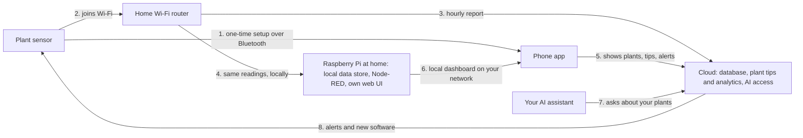
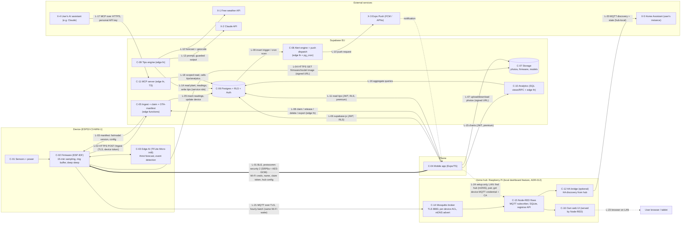

# Plant Monitor — System Architecture (task 2.1)

Status: **draft v0.3 (PROPOSAL; adds high-level design, Node-RED + own web UI on the Pi per owner answers on PR #3) for the G2 design review (Fri 2026-11-06)** · Author: Theo (System Architect) · Date: 2026-11-03
v0.3 adds section 0 (high-level design of the final product) and applies the owner answers (Pi only for the local dashboard, Node-RED + own web UI, Pi 3 or any locally available model, +38 h accepted). v0.2 added (a) the BLE-only setup / Wi-Fi-only operation flow with encrypted credential provisioning (ADR-011) and (b) a required Raspberry Pi local hub fed by MQTT in parallel to the cloud path (ADR-012). Both are **Proposed** and change Requirements v0.1; section 10 lists the proposed requirement, Plan and BOM changes. Nothing in the Requirements doc has been edited.
Synced with: Requirements v0.1 (Google Doc `1T4k3rK4KQDeGtIN8pjdmohGUAohFrtATLhMYSBsYA6g`) and Questions Q-01..Q-16.
Out of scope here: DB schema and API spec (task 2.4), risk register (2.8), cost model (2.6). Open points for those are in section 8.

## 0. High-level design (final product)

This is the picture of the finished product, in plain words. The detailed design in sections 1-10 explains how each box is built.

**End-to-end flow**

1. **Setup (once).** You power on the sensor. The app finds it over Bluetooth. Your home Wi-Fi name and password are handed to the sensor through an encrypted channel, and the sensor is linked ("claimed") to your profile in the same step. Afterwards Bluetooth is switched off for good. The Wi-Fi password is kept only on the sensor (and optionally in your phone's secure storage), never in the cloud.
2. **Normal operation.** The sensor measures every 15 minutes and runs a tiny AI model on the device itself to forecast thirst and spot problems. Once an hour it switches Wi-Fi on and sends its readings to the cloud and, at the same moment, to the Raspberry Pi at home (MQTT). If something critical happens (for example the soil is bone dry), it does not wait for the hour and reports and raises an alert straight away.
3. **Viewing.** The phone app shows your plants, charts and alerts from the cloud. On your home network you can also open the local dashboard on the Raspberry Pi, which keeps working when the internet is down.
4. **Premium features.** The cloud adds care tips (weather and plant aware), longer analytics, and an access point for your own AI assistant (MCP) so you can ask "which of my plants needs water?".
5. **Updates (OTA).** New sensor software or AI models are downloaded over Wi-Fi at the next report and installed safely, with automatic roll-back if something goes wrong.

**Who talks to whom, over what**

| From -> to | Over what | What is sent |
|---|---|---|
| Phone app -> sensor | Bluetooth, encrypted, setup only | Wi-Fi details, name, claim to your profile |
| Sensor -> cloud | Wi-Fi, internet (HTTPS), hourly or on a critical event | Readings, forecast, events; receives settings and updates |
| Sensor -> Raspberry Pi | Wi-Fi, home network (MQTT with TLS), hourly | Same readings |
| Phone app / AI assistant -> cloud | Internet (HTTPS; MCP for the assistant) | Plants, charts, tips, alerts; read-only questions |
| Browser or phone -> Raspberry Pi | Home network only | Local dashboard (own web UI), Node-RED flows |

**Decided and unchanged vs still open**

- *Decided by the owner (PR #3):* the Raspberry Pi is needed only for the local-dashboard feature (app and cloud work without it); no Wi-Fi password in the cloud; Pi 3 or any model sold in the Egyptian market; own web UI plus Node-RED on the Pi; about +38 h of extra work accepted.
- *Unchanged:* the cloud (Supabase EU) stays the system of record; sensor hardware and BOM; on-device AI every 15 min; tips, analytics and MCP are premium and checked on the server.
- *Still open (section 10.4):* Q-H6 encrypt the stored Wi-Fi data on the sensor or accept plain flash for the demo; Q-H7 TLS or plain MQTT on the home network (recommended: TLS); Q-H8 OTA signing, SHA-256 over TLS (recommended) or signed images (Plan 4.F4 says signed); Q-H9 remaining scope cuts if the schedule slips (the +38 h itself is accepted); Q-H10 local-only dashboard access, no remote access. Q-H5 (hourly local publish) is assumed hourly, matching the flow above.

## 1. Overview

A battery device (ESP32-C3-MINI-1) samples soil moisture, air temperature, air humidity, light and battery every 15 min with Wi-Fi off, runs two tiny int8 models on the device (thirst forecast, event/fault detection) and reports to a standalone cloud once per hour, or immediately on a critical event. The cloud is Supabase (EU): Postgres with RLS, Auth, Storage, Edge Functions. A React Native (Expo) app talks to Supabase directly under RLS for plain reads/writes and to edge functions for anything that needs server logic. Premium features (tips engine, analytics, MCP server) are edge functions that check a per-user flag server-side. **v0.2:** each sensor additionally publishes the same readings over MQTT (on the same Wi-Fi wake) to a Raspberry Pi "hub" in the user's home, which runs the broker, Node-RED and a local dashboard (own web UI) and is required for the local-dashboard feature only; app and cloud work without it (ADR-012). The cloud path is unchanged and remains the system of record for the app. A Home Assistant bridge stays optional and now hangs off the hub instead of the cloud (ADR-010 amended).

## 2. Diagram

Text form of the data path: sensors -> firmware (15 min) -> AI features -> RAM/flash ring buffer -> hourly Wi-Fi wake -> (1) `POST /ingest` (batch of samples + forecast + events) -> Postgres -> app (Realtime or pull) / alert engine -> push, and in parallel (2) MQTT publish to the Pi hub -> Node-RED -> SQLite -> own web UI (v0.2). BLE is used only in setup mode; in normal operation the radio is Wi-Fi only.

## 3. Components

Owner = role that builds it (TEAM.md §2); Theo reviews every PR. Requirement IDs are from Requirements v0.1.

| ID | Component | Owner | Responsibility | Traces to |
|---|---|---|---|---|
| C-01 | Sensors + power (moisture, AHT20, BH1750, battery ADC, USB-C charger, LED, pinhole button) | Emil (PCB), Mira (drivers) | Produce the five values, charging indication, reset input | FR-D01, FR-D06, FR-D07, NFR-01, NFR-02, NFR-08, NFR-09 |
| C-02 | Firmware (ESP-IDF 5.x, C): sampling, calibration, ring buffer, deep sleep, BLE provisioning (setup mode only, security 2), Wi-Fi/TLS client, MQTT client for the hub, OTA with rollback, factory reset | Mira | Everything on the device except the models | FR-D01..D07, FR-E03, NFR-01, NFR-06; proposed FR-D08, FR-D09 |
| C-03 | Edge AI: model A (thirst forecast), model B (event/fault), feature extraction; int8, <30 KB flash, <20 KB RAM, <50 ms | Mira (models, ML under `ml/`), Sana (training infra) | Forecast + events computed on the device every 15 min | FR-E01..E04, FR-A07 (AI events), Q-16 |
| C-04 | Mobile app (Expo, TS, iOS + Android): auth, setup flow, plants, gallery, charts, alerts, premium screens, account export/delete | Leo | All user interaction; BLE client for setup; mDNS client for hub pairing | FR-A01..A08, FR-P01..P04 (UI), UC-01..UC-12, NFR-03, NFR-04 |
| C-05 | Ingest + claim + manifest edge functions; `DELETE /account` (account deletion, edge function `delete-account`, owner Sana, Plan 4.B2b; Leo's app consumes it; `verify_jwt=false` in `config.toml`, the function validates the user JWT itself with `auth.getUser()`; order as in `openapi.yaml` `/account`) | Leo (4.B1/4.B2), Sana (4.B2b `DELETE /account`), contract by Theo (2.4) | Authenticate device, validate and store reports, claim/release, hand out OTA manifest and config (thresholds) | FR-D02, FR-D03, FR-D04, FR-D05, FR-A02, FR-A08, NFR-04, NFR-06 |
| C-06 | Postgres + Auth + RLS (+ Realtime) | Leo | System of record; every table has RLS; premium flag per user | FR-A01, FR-A04, FR-P04, NFR-06, NFR-07 |
| C-07 | Storage (private buckets: photos, firmware, models) | Leo | Photos per plant, signed URLs; versioned firmware/model blobs | FR-A05, FR-D05, NFR-07 |
| C-08 | Alert engine + push dispatch | Leo (no Plan row yet; proposed new 4.B8, see section 10) | Too dry/wet, low battery, offline (missed reports), edge-AI events; dedupe so each alert fires once | FR-A07, FR-D06, FR-E03, NFR-04 |
| C-09 | Tips engine | Sana (4.B3) | Weather + season + plant + readings -> Claude -> output filtered by deterministic safety rules | FR-P02, FR-P04, Q-13 |
| C-10 | Analytics (30/90-day history, trends, watering events, compare) | Sana (4.B4) | SQL aggregations behind a premium check | FR-P01, FR-P04 |
| C-11 | MCP server (`list_plants`, `get_plant_status`, `get_history`, `get_tips`) | Sana (4.B5) | Personal API keys (hashed, revocable), read-only, premium-gated | FR-P03, FR-P04, NFR-06 |
| C-12 | HA/MQTT bridge (optional, "Could") | Leo (Plan 4.B6, now hub-side) | Publish HA MQTT-discovery entities from the hub's local data (v0.2; was: from cloud state to a user broker) | FR-I01 |
| C-14 | Hub broker: Mosquitto 2.x on Raspberry Pi, TLS, dynamic-security ACLs, mDNS advertisement | proposed 4.H1 (Mira firmware side, Leo hub side; Lead to assign) | Receive device MQTT; per-device auth and topic ACL | proposed FR-H01, FR-D08, NFR-06 |
| C-15 | Node-RED on the Pi (flows kept in the repo, JSON): MQTT subscriber, SQLite store, registrar HTTP API (pairing, device credential issue/revoke), HA bridge flow | proposed 4.H2 (Node-RED flows) | Persist readings locally, issue broker credentials to the app during setup | proposed FR-H01, FR-H02 |
| C-16 | Own local web UI (small static TypeScript/JS app served by Node-RED, reading its HTTP API): plant list, latest values, charts, battery/offline status | proposed 4.H3 | Dashboard that works without internet | proposed FR-H03, NFR-11 |
| C-13 | CI/CD, OTA release pipeline, secrets | Kai | Build/sign firmware and model artefacts, deploy functions, migrations | FR-D05, NFR-06 |
| X-1..X-5 | External: weather API, Claude API, Expo Push, user's AI assistant, user's Home Assistant | — | Third-party; no secrets in repo | Q-13, FR-P03, FR-I01 |

## 4. Interfaces per link

Contracts are written in 2.4 (`docs/interfaces/`); this table fixes the style and the facts they must honour.

| Link | From -> To | Protocol / format | Auth | Contract (to be written in 2.4) | Traces to |
|---|---|---|---|---|---|
| L-01 | App -> device | BLE GATT via ESP-IDF `wifi_provisioning` (protocomm **security 2**: SRP6a handshake with the PoP/password from the label/QR, then AES-GCM-encrypted endpoints) + custom endpoints `nw-claim` (name, claim token) and `nw-hub` (hub host, port, CA cert, MQTT credential). Setup mode only. See ADR-011 | SRP6a (PoP) | `interfaces/ble-provisioning.md` | FR-D03, FR-A03, NFR-03, proposed NFR-10 |
| L-02 | Device -> ingest | HTTPS POST, JSON, TLS 1.2+ with pinned CA | `Authorization: Bearer <device token>` | `interfaces/device-report.schema.json` + OpenAPI `/ingest` | FR-D01, FR-D02, FR-D04, NFR-06 |
| L-03 | Ingest -> device | HTTP response body | same call | `{server_time, fw_target, model_target, config{thresholds, sample_interval}}` | FR-D05 |
| L-04 | Device -> Storage | HTTPS GET, signed URL from manifest | URL expiry | firmware/model image + SHA-256 | FR-D05 |
| L-05 | Ingest -> DB | SQL (service role, inside edge function only) | service role secret | DB schema (2.4) | FR-D02, FR-E01 |
| L-06 | App -> DB | supabase-js, PostgREST + Realtime | user JWT, RLS | DB schema + RLS policies (2.4) | FR-A01..A06, NFR-06 |
| L-07 | App <-> Storage | HTTPS, signed URLs | user JWT | bucket policy | FR-A05 |
| L-08 | App -> edge fn | HTTPS JSON: claim, release, delete account, export, key mgmt | user JWT | OpenAPI | FR-A01, FR-A08, NFR-07 |
| L-09 | DB -> alert engine | insert trigger + pg_cron scan (offline detection) | internal | alert rules doc | FR-A07 |
| L-10 | Alert -> Expo Push | HTTPS | access token (secret) | payload with no sensitive data | FR-A07 |
| L-11 | App -> tips (read) | HTTPS, PostgREST on `public.tips` | user JWT; RLS `tips_select_own_premium` (own rows, premium only) | `db-schema.sql` table `tips` (no `/tips` edge function) | FR-P02, FR-P04 |
| L-12 | Tips -> weather | HTTPS REST | none/API key | provider adapter interface | FR-P02, Q-13 |
| L-13 | Tips -> Claude API | HTTPS, structured JSON output | API key in Supabase secret | prompt + output schema + rule list | FR-P02, Q-13 |
| L-14, L-16, L-18 | Edge fn -> DB | SQL | scoped role / RPC (tips writes: service role only) | schema | FR-P01..P03 |
| L-15 | App -> analytics | HTTPS | JWT + premium | OpenAPI `/analytics` | FR-P01 |
| L-17 | AI assistant -> MCP | MCP, Streamable HTTP | `Bearer <personal API key>` (hash stored, revocable) | `interfaces/mcp-tools.json` | FR-P03, NFR-06 |
| L-20 | Hub HA bridge -> HA | MQTT 3.1.1/5, HA discovery topics (broker is the hub's Mosquitto, or a bridge to the user's HA broker) | hub-local credentials | `interfaces/ha-discovery.md` | FR-I01 |
| L-21 | Device -> hub broker | MQTT 3.1.1 over TLS (8883), topics `nilwerk/v1/<device_id>/{telemetry,event,status}`, JSON payload, QoS 1; payload and topics in ADR-012 | per-device username/password, topic ACL, pinned hub CA | `interfaces/hub-mqtt.md` (+ shared sample schema with `device-report.schema.json`) | proposed FR-D08, NFR-06 |
| L-22 | Broker -> Node-RED | local MQTT subscribe `nilwerk/v1/+/#` | service account | same | proposed FR-H01 |
| L-23 | Browser -> dashboard | HTTP(S) on LAN, no port forwarding | admin password set at install (open question) | `interfaces/hub-api.md` | proposed FR-H03 |
| L-24 | App -> hub (setup only) | HTTPS on LAN, mDNS `_nilwerk-hub._tcp`; pair with code shown on hub, request device credential + CA | pairing code, then hub admin session | `interfaces/hub-api.md` | proposed FR-H02, FR-A03 |

## 5. Key flows

**Setup (UC-02, FR-D03, FR-A03; accepted (A-080, 2026-11-12), ADR-011).**
1. The app (user signed in) asks the `claim` function (L-08) for a one-time claim token bound to the user's profile. Separately, if a hub is on the LAN, the app finds it via mDNS, pairs with the code shown on the hub, and requests a per-device MQTT credential plus the hub CA certificate (L-24). Phone and hub are on the home LAN at this point.
2. The user powers the sensor, or holds the button: setup mode, BLE advertising (the only time BLE is on).
3. The app connects over BLE and runs the protocomm **security 2** handshake (SRP6a using the PoP from the label/QR as password; the device holds a per-unit salt and verifier, so the PoP itself is never sent). All following traffic is AES-GCM encrypted with the session key.
4. Over that encrypted channel the app sends: Wi-Fi SSID and passphrase, device name, claim token, hub host/port/CA certificate/MQTT credential.
5. The device stores the Wi-Fi credentials, the hub config and later its device token in NVS, turns BLE off, joins Wi-Fi and calls `/device-claim` once with the claim token (ADR-013; was `/ingest` in v0.3); the function creates the device row, issues the per-device token (returned once), and consumes the claim token. The device also makes a test publish to the hub. The app sees the device via Realtime; plant details and first photo are saved by the app.
6. From now on the sensor never uses BLE again in normal operation. Factory reset (FR-D07) wipes NVS and re-enters setup mode; release (FR-A08) revokes the cloud token and the hub credential and clears `owner`.

What is encrypted, and where: Wi-Fi passphrase, claim token and MQTT credential are encrypted in transit over BLE (security 2). The BLE advertisement (device name prefix, address) is not. On the phone the Wi-Fi password is held only in the OS keystore, if the user chooses to remember it. In the cloud profile: **no Wi-Fi password** (recommended; see ADR-011 for the trade-off versus an end-to-end-encrypted copy). On the device: NVS, plaintext unless NVS encryption is enabled (accepted risk A-155 for the v1 demo, see ADR-004; open question Q-H6).

**Reporting (FR-D01/D02/D04).** Every 15 min: wake, sample, calibrate to 0-100 % relative moisture, update features, run models, append to ring buffer in flash, sleep. Every 4th wake (or on critical event, FR-E03): Wi-Fi on, SNTP, POST all unsent samples with the latest forecast and event flags; delete only after HTTP 2xx. **v0.2:** in the same Wi-Fi session the device also publishes the new samples to the hub (L-21, QoS 1, short timeout, connect-publish-disconnect); a hub failure never blocks or delays the cloud POST and is not retried from the buffer (the cloud copy is complete; the hub shows a gap). Order: cloud POST first, hub publish second, so the OTA/ingest rollback logic is unchanged. Without Wi-Fi the buffer keeps >= 24 h (96 samples) and is sent on reconnect; backoff avoids draining the battery.

**Alerts (FR-A07).** Ingest writes readings; a trigger evaluates thresholds from the plant (too dry/wet), battery threshold, and device event flags; a cron job marks a device offline after 3 missed hourly reports (G1). Each alert has a state row so it fires once until resolved. Push goes through Expo Push (L-10).

**OTA (FR-D05).** The ingest response carries the target firmware/model version. Device downloads to the inactive OTA slot, verifies SHA-256 (and signature, see open issue O-3), reboots, and marks the image valid only after a successful ingest call; otherwise ESP-IDF rollback restores the previous slot. Models live in their own partition so they can update without a firmware change.

**Local dashboard (proposed FR-H03).** Node-RED receives telemetry from Mosquitto, writes to SQLite (about 4 rows per device per hour), and serves the web UI on the LAN. Works with the internet down. Offline sensor (no publish for 3 missed hourly reports) is shown from the broker `status` LWT and a last-seen timer. See ADR-012.

**Tips (FR-P02).** App requests tips for a plant -> function checks premium flag -> loads plant, recent readings, place -> weather forecast -> builds prompt -> Claude returns structured JSON -> deterministic rule layer clamps or removes unsafe advice (e.g. no watering when soil is waterlogged, no fertilising in frost, no direct-sun advice during heat warnings) -> cached per plant for a few hours.

**MCP (FR-P03).** User creates a key in the app (shown once, hash stored). The assistant calls MCP tools; each call is authenticated by key, mapped to a single user, read-only, premium-checked; revoke deletes the hash and the next call fails.

## 6. Cross-cutting decisions

| Topic | Decision | ADR |
|---|---|---|
| MCU + on-device AI | ESP32-C3-MINI-1, ESP-IDF, TFLite Micro int8 | ADR-001 |
| Setup + claim | BLE provisioning with PoP, one-time claim token (ADR-002); v0.2 upgrade: security 2 + encrypted credential handling, BLE only in setup | ADR-002, ADR-011 (Accepted, A-080, 2026-11-12) |
| Backend | Supabase EU; edge functions for ingest, tips, analytics, MCP | ADR-003 |
| Device identity | Per-device bearer token, hashed in DB, revocable | ADR-004 |
| App | Expo + TS, supabase-js direct under RLS | ADR-005 |
| Tips | Weather API + Claude + deterministic rule guardrails | ADR-006 |
| MCP | Edge function, personal API key, read-only | ADR-007 |
| Premium | Server-side flag, no payments | ADR-008 |
| OTA | Manifest in ingest response, dual slot + rollback | ADR-009 |
| HA | Optional MQTT bridge, v0.2: hosted on the hub | ADR-010 (amended), ADR-012 |
| Local hub | Raspberry Pi (Pi 3 or any locally available model): Mosquitto + Node-RED + own web UI, fed by device MQTT in parallel with the cloud path | ADR-012 (Proposed) |

Security baseline (NFR-06/07): TLS everywhere (device -> cloud and device -> hub); RLS on every table; service role used only inside edge functions; secrets only in Supabase/GitHub secrets, referenced by name; EU region for DB and Storage; account deletion cascades through DB rows and Storage objects; export is a JSON + photos bundle.

## 7. Requirement coverage check

Every FR/NFR below maps to at least one component, except NFR-05 (enclosure), which has no component ID or ADR and is owned by name only (Yara, Plan 4.E3/4.E4). Proposed v0.2 items are in section 10.

| Req | Component(s) | Req | Component(s) |
|---|---|---|---|
| FR-D01 | C-01, C-02 | FR-A06 | C-04, C-06 |
| FR-D02 | C-02, C-05 | FR-A07 | C-08, C-03, C-04 |
| FR-D03 | C-02, C-04, C-05 | FR-A08 | C-04, C-05, C-06 |
| FR-D04 | C-02, C-05 | FR-P01 | C-10, C-04 |
| FR-D05 | C-02, C-05, C-07, C-13 | FR-P02 | C-09 |
| FR-D06 | C-01, C-02, C-08 | FR-P03 | C-11 |
| FR-D07 | C-01, C-02 | FR-P04 | C-06 (flag), C-09/C-10/C-11 (enforce) |
| FR-A01 | C-04, C-06, C-05 | FR-I01 | C-12 |
| FR-A02 | C-05, C-06 | FR-E01..E04 | C-03 (+C-02 for E03, C-08 for alert) |
| FR-A03 | C-04, C-02, C-05 | NFR-01 | C-01, C-02 |
| FR-A04 | C-04, C-06 | NFR-02 | C-01, C-02 (calibration) |
| FR-A05 | C-04, C-07 | NFR-03 | C-04, C-02 |
| NFR-04 | C-05, C-06, C-04 | NFR-05 | none; owned by Yara (4.E3/4.E4), outside this doc |
| NFR-06 | C-02, C-05, C-06, C-11 | NFR-07 | C-05, C-06, C-07 |
| NFR-08 | C-01 (PCB) | NFR-09 | C-01 (BOM, task 2.5) |

## 8. Open issues and risks (hand-over to 2.4 and 2.8)

For **2.4 (DB schema + API spec)**:
- D-1 Report schema: batch of up to 192 timestamped samples per request (96 = the 24 h offline buffer case, FR-D04; more than 192 go in several requests; `device-report.schema.json` maxItems 192) + `fw`, `model`, `forecast_h`, `events[]`; define units (relative moisture 0-100 %, raw ADC kept for retraining, FR-E01 domain-gap note), idempotency key (device_id + sample ts) so retries do not duplicate.
- D-2 Retention/volume: 4 samples/h/device raw; decide raw vs hourly roll-up for 30/90-day charts (FR-P01) and training data kept for retraining (Req §5).
- D-3 RLS on all tables incl. `devices`, `device_tokens`, `api_keys`, `alerts`, `tips`; ingest uses service role only inside the function; MCP must not hold a broad service-role path (use RPC keyed by API-key hash).
- D-4 Claim/release state machine (token TTL, single use, release revokes device token, re-claim by a second account, FR-A08).
- D-5 Plant thresholds: per plant (dry/wet points for calibration and alert) pushed to device in the manifest `config`.
- D-6 Alert state table and dedupe rules; offline = 3 missed hourly reports (decided at G1, see ADR-013).
- D-7 Account deletion cascade including Storage objects and API keys (FR-A01, NFR-07); export format.
- D-8 Time: device RTC drifts in deep sleep; server stamps `received_at`, device sends `sample_age_s` plus SNTP-synced `ts`.

For **2.8 (risk register)**:
- O-1 Battery (NFR-01): 15-min wakes plus hourly TLS handshakes (v0.2: two of them, cloud and hub) may break the 3-month typical-case target (A-020; was 6 months; flexed 2026-11-08, ADR-015: best/typical >= 3 months, worst > 1 month); needs an early current budget (task 5.4) and a fallback (30-min sampling, or longer Wi-Fi interval when no event). Owner Mira/Emil.
- O-2 Latency (FR-E03 <= 15 min): an immediate Wi-Fi wake on a critical event costs a TLS session; false events drain battery. Limit wakes per day. QA (PR #3 finding 3) notes that with a 15-min cadence the strict 15 min cannot hold literally (about 15 min + connect time); the critical-event set from the 2.4 work (PR #4) becomes the event enum in the report schema; waterlogged/fast-drying are debounced and outside the FR-E03 claim.
- O-3 OTA integrity: ESP-IDF secure boot / signed images are not planned; decide whether SHA-256 over TLS is enough for the demo (recommended) and document the gap vs CE/RED later.
- O-4 BLE provisioning on iOS and Android with Expo: the maintained ESP provisioning library needs a dev build (not Expo Go); verify on both platforms in week 1 (FR-D03, NFR-03).
- O-5 Privacy/EU (NFR-07): Claude API and Expo Push are processed outside the EU. Send only pseudonymous plant data and the city name, no user identity; confirm acceptable with Arsany and mention in privacy notes. See A-1.
  **Owner decision A-156 (2026-11-28, Arsany, NFR-07, FR-P04): live LLM tips are OFF.** Tips stay rule-based (`baselineTips` plus guardrails) until an EU-hosted or DPA-covered provider is chosen. The only code path that sends plant context to an LLM is live mode in `projects/plant-monitor/cloud/tips/engine.ts`: the gate is `mode === "live"` (line 103), the context is built at line 104 and sent through `assist` at line 105. The default mode is `rule_based` (line 101).
- O-6 Weather API licence (Q-13 "free"): some free tiers are non-commercial only; confirm the provider's terms fit a sales demo (and later client use) in 2.6.
- O-7 LLM safety (FR-P02): rule layer must be unit-tested with adversarial model outputs; model output must be schema-validated before display. Owner Sana/Ines.
- O-8 Edge-AI domain gap (Req §5): public probes differ from ours; FR-E01/E02 acceptance is on public data only, real-unit check in week 4.
- O-9 Supabase free-tier limits (edge function invocations, pg_cron, Realtime connections) with 3 units are fine, but cost per premium user (Claude calls) belongs in 2.6.
- O-10 Hardware-in-the-loop tests (BLE, deep sleep, OTA rollback) need Arsany's hands; plan procedures in 5.5.
- O-11 Schedule: 4-week plan (~200 h) is tight; the HA bridge (C-12) is the first thing to cut.

- O-12 (v0.2) Hub as single point of failure for the local dashboard and a new install step for every customer (SD card, power, network); local-network pitfalls (client isolation, guest Wi-Fi, mDNS blocked) break sensor-to-hub publishing. Mitigation: cached IP + config fallback, hub status in the app.
- O-13 (v0.2) App BLE library may not support protocomm security 2 (the Plan names `@orbital-systems/react-native-esp-idf-provisioning`); verify in week 1 together with O-4, otherwise security 1 (X25519 + PoP, AES-CTR) is the fallback.
- O-14 (v0.2) Wi-Fi credential handling (ADR-011): home Wi-Fi password in the cloud would be a high-value breach target; recommended not to store it.
- O-15 OTA signing: Plan 4.F4 says "Signed images", ADR-009/O-3 defers secure boot (QA finding 2). Needs a decision from Arsany; see Q-H8.

Items needing Arsany (via Lead): **A-1** accept that Claude API and Expo Push process data outside the EU (pseudonymised), or choose a different path; **A-2** confirm the weather provider chosen in 2.6 is acceptable licence-wise. ADR-006, ADR-010, ADR-011 and ADR-012 are *Proposed* until the G2 review; ADR-001/002/004/007/009 are accepted for G2 review only (QA finding 8). New v0.2 questions: section 10.4.

## 9. Changes against the role file

The role file lists ADRs under `docs/decisions/`; this task asked for `docs/adr/`. ADRs are in `docs/adr/`; the empty `docs/decisions/` can be removed later by the Lead if Arsany agrees.

## 10. Proposal: impact of the v0.2 change (not yet approved)

Source: owner comment on PR #3: sensor is initialised and bound to the user's profile via the app over Bluetooth with Wi-Fi data provisioned encrypted, afterwards the sensor uses only Wi-Fi to send to the database; in parallel a Raspberry Pi is required for a local dashboard and each sensor sends MQTT data.

### 10.1 Requirements v0.1: items that change or are added (Requirements doc not edited)

> **Update 2026-11-06 (Arsany, A-023): the Raspberry Pi hub is not part of v1.** FR-H01..H03, FR-D08, FR-D09 and the pairing screen S17 move to v1.1; 4.A3 does not wait for them. The hub rows below stay as the v1.1 design. Consequence: the v1 NFR-01 budget does not need the hub publish (it is a saving, see power-budget.md section 7).

| ID | Change | Proposed wording / note |
|---|---|---|
| FR-D03 | Changed | Setup mode (first boot or button): over BLE, using an encrypted, authenticated channel (protocomm security 2), receive Wi-Fi credentials, device name, claim token and hub configuration. |
| FR-A03 | Changed | Setup flow: find device -> (pair with hub if present) -> Wi-Fi -> name -> photo -> plant details. |
| FR-D02 | Changed | Report to the cloud once per hour **and** publish the same readings to the local hub in the same Wi-Fi session. |
| FR-D04 | Clarify | Offline buffer feeds the cloud only; the hub is best effort (gaps accepted). |
| FR-A08 | Changed | Release also revokes the device's hub credential. |
| FR-I01 | Changed (C) | Home Assistant integration via MQTT discovery is served from the hub (Node-RED flow) rather than the cloud. |
| NFR-01 | Clarified, then flexed | **Best and typical case >= 3 months, worst case > 1 month** (A-020/A-021; flexed by Arsany 2026-11-08, ADR-015; 6 months is a stretch goal for a later version) at hourly reporting **including** the hub publish; to be proved in 5.4. |
| NFR-03 | Changed | Setup <= 3 min measured with the hub already installed. Hub install is separate. |
| NFR-06 | Extended | Also: Wi-Fi credentials never in plaintext over BLE; no Wi-Fi password in cloud storage; per-device broker credentials and topic ACL; TLS to the hub. |
| NFR-07 | Extended | Wi-Fi credentials are not personal data we hold (not stored in cloud); data export/delete includes hub data guidance. |
| Sec. 7 "Standalone cloud ... HA only optional (Q-04)" | Changed | Cloud remains the system of record; a Raspberry Pi hub is needed for the local dashboard only. |
| FR-D08 (new, M) | Added | Publish readings to the hub over MQTT/TLS with per-device credentials. |
| FR-D09 (new, M) | Added | In normal operation the device uses Wi-Fi only; BLE is active only in setup mode. |
| FR-H01 (new, M) | Added | The hub runs an MQTT broker (TLS, per-device auth) and stores received readings locally. |
| FR-H02 (new, M) | Added | The app pairs with the hub on the LAN and issues/revokes device credentials during setup/release. |
| FR-H03 (new, M) | Added | Local dashboard: plants, latest values, history charts, battery and offline status. |
| NFR-10 (new, M) | Added | Provisioning security: authenticated, encrypted BLE channel; PoP never transmitted; brute-force attempts limited. |
| NFR-11 (new, M) | Added | Local dashboard and device-to-hub publishing work without internet. |
| UC-13 (new) | Added | See current and past plant data on a local dashboard at home. UC-02 gains the hub-pairing step. |

### 10.2 Plan impact (rough, hours added to the current Est.; Lead to refine)

Existing rows: **4.F2** 8 -> 12 h (+4: security 2, custom endpoints, hub config storage, BLE-off in normal mode); **4.A3** 8 -> 12 h (+4: security 2 client, mDNS + hub pairing, dev build on both OSes); **4.B6** 3 -> 2 h (-1: bridge moves onto the hub; cloud bridge dropped); **2.4** +1 (MQTT topic/payload + hub API contracts); **2.3 / 5.4** +1.5 (power budget with second publish, measurement); **5.5** +2 (hub, MQTT, mDNS tests); **5.9** +1 (credential handling, ACL tests); **6.2** +1 (hub quick-start).
New rows (IDs for the Lead to assign): **4.H1** hub broker setup (Mosquitto, private CA, dynamic-security, mDNS, install script) 5 h; **4.H2** Node-RED hub flows (subscriber, SQLite, registrar API) 6 h; **4.H3** local web dashboard 8 h; **4.F6** firmware MQTT client (TLS, cached-IP + mDNS, QoS 1, LWT, timeouts) 6 h; **4.B8** alert engine and push dispatch (C-08, QA finding 1; independent of v0.2) 4 h.
Total v0.2 delta: about +38 h (without 4.B8), roughly +19 % on the ~200 h plan. These are my estimates, not measured. The HA bridge (4.B6) remains the first thing to cut; if schedule is fixed, FR-H03 can start as a plain table/chart page.

### 10.3 BOM impact (prices unverified, no ordering)

Sensor BOM: no change (the ESP32-C3 has Wi-Fi and BLE on-chip). New, once per household (demo: 1 hub shared by the 3 units, plus optionally 1 dev hub): Raspberry Pi 3 or any model available in the Egyptian market (owner answer; Node-RED + Mosquitto + SQLite run fine on a Pi 3, Ethernet preferred), price to be checked locally (a Pi 3/4 was roughly EUR 40-60 elsewhere); microSD 32 GB A1/A2 about EUR 8-15; USB-C power supply about EUR 10-15; optional case EUR 5-10. Indicative hub total EUR 60-100. All figures are recollection-based and unverified; Emil/Arsany to check live prices and stock in 2.5.

### 10.4 Questions for Arsany

Answered by the owner on PR #3 (Q-H1..Q-H5; Q-H9 also answered):

- Q-H1 **Answered:** the Pi is required for the local-dashboard feature only; app and cloud work without it.
- Q-H2 **Answered:** no Wi-Fi password in the cloud (stays on the sensor; phone keystore optional).
- Q-H3 **Answered:** Raspberry Pi 3 or any model available in the Egyptian market. Still to settle in 4.H1: SD image vs install script.
- Q-H4 **Answered:** own web UI plus Node-RED (ADR-012 updated; no Grafana/InfluxDB).
- Q-H5 **Taken as hourly** (batch with the cloud report), as in his description of the flow; no live 15-min publishing.
- Q-H9 **Answered:** about +38 h accepted. The HA bridge remains the first cut if the schedule slips.

Still open:

- Q-H6 NVS encryption of Wi-Fi credentials and device token on the device (needs eFuse burning, irreversible, needs your hands) or accept plaintext in flash for the demo?
- Q-H7 Plain MQTT without TLS on the LAN (saves handshake time) or TLS (recommended)?
- Q-H8 OTA signing (Plan 4.F4 "Signed images" vs ADR-009 defers secure boot): decision needed (QA finding 2). Recommendation: SHA-256 over TLS for the demo.
- Q-H10 Is local-only access to the dashboard fine (no remote access, no port forwarding)?
