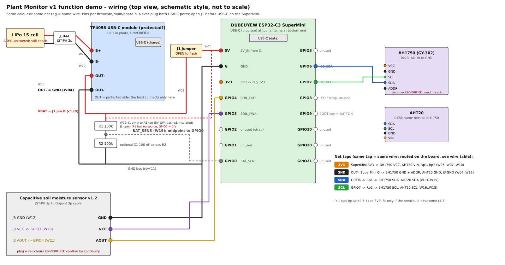
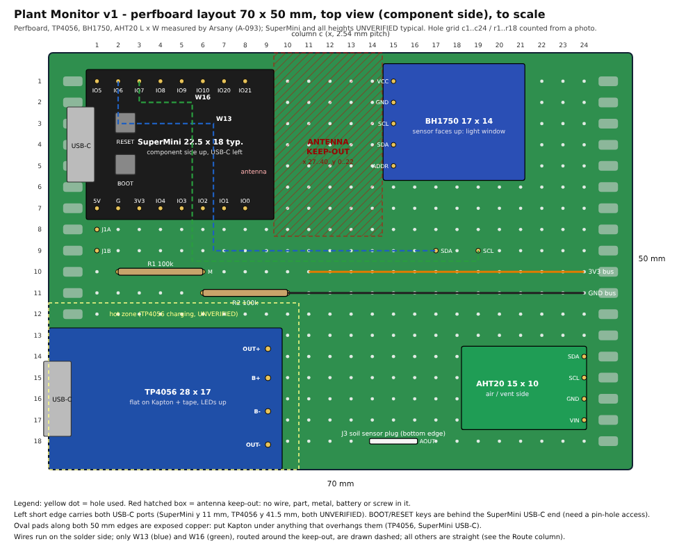

# Plant Monitor v1 (function demo) - wiring guide

Author: Emil (PCB Designer) - 2026-11-14 - branch `agent/pcb/v1-wiring`. Revision 2 closes Theo's review conditions C1-C5 (PR #101): cell facts and R_PROG (2.6), antenna-safe routes (4), divider on the switched side of J1 (2.7), flash with J1 open (2.3), J2 defined (8).
Audience: Arsany (builds it), Yara (3D designer, housing data in sections 5 and 6), Mira (firmware, pins unchanged).

**What this is.** Owner decision 2026-11-14: v1 is a function demo built from parts Arsany already owns plus a DUBEUYEW ESP32-C3 SuperMini.
v2 (our custom PCB) keeps routing at low priority; nothing else in the project changes. The pin assignment is fixed by
`projects/plant-monitor/firmware/main/board.h` (lines 23-28) and is **not changed here**.

**Convention.** `UNVERIFIED` = taken from a photo, a listing screenshot or typical values; not measured, not read from a datasheet today.
Nothing below is a measured result. Dimensions are typical values until Arsany fills the measure list (section 6).
v1 numbers (current, deep sleep, charge) must never be quoted as product figures (playbook rule 5: dev-kit regulators, LEDs and the
permanent divider distort deep-sleep current).

**Diagrams** (generated from `gen_wiring.py`, the single source of the wire table):
[`wiring-diagram.svg`](wiring-diagram.svg) / [`wiring-diagram.png`](wiring-diagram.png) and
[`perfboard-layout.svg`](perfboard-layout.svg) / [`perfboard-layout.png`](perfboard-layout.png).




---

## 1. Parts list (what each part does)

| # | Part (as seen in photos 1-3 / listing) | Role in v1 | Used? |
|---|---|---|---|
| 1 | DUBEUYEW ESP32-C3 SuperMini (ESP32-C3FN4, 4 MB flash, USB-C, BOOT + RESET keys, LDO CAT6219-330, ceramic antenna) | the MCU; runs the firmware; programmed over its own USB-C | yes |
| 2 | TP4056 USB-C charger module with 3 ICs (photo: TP4056 + two 8-pin chips, probably DW01 + 8205A = protected variant, UNVERIFIED) pads B-, B+, OUT-, OUT+ | charges the 1S LiPo over its USB-C; protected OUT pads feed the SuperMini | yes |
| 3 | 1S LiPo cell, as decided in A-034 and planned for v2: EEMB LP603449-PCM, 51 x 34.5 x 6.3 mm, 1000 mAh minimum (1100 typical), max charge 1100 mA (1C), max discharge 2200 mA, built-in protection board per the listing (facts read in `hardware/power-budget/power-budget.md` section 8 and `hardware/bom/cell-decision-A034.md` section A; tolerance, swelling and plug pitch are not stated there: UNVERIFIED); plug JST-PH 2.0 mm, red = +, black = - (A-091 answered by Arsany; meter check stays) | the battery | yes (cell not in the photos) |
| 4 | 2-pin JST-PH lead (red/black) | battery plug J_BAT, soldered to B+/B-. In photos 1-2 the red/black lead seen is attached to the AA holder: UNVERIFIED that Arsany has a separate pigtail | yes, if free |
| 5 | BH1750 (GY-302) breakout, 5 pins | ambient light, I2C 0x23 | yes |
| 6 | AHT20 breakout, pins SDA SCL GND VIN | air temperature + humidity, I2C 0x38 | yes |
| 7 | Capacitive soil moisture sensor v1.2 with 3-pin JST-PH cable (GND VCC AOUT) and a 3-pin Dupont plug | soil moisture, analog | yes |
| 8 | Perfboard 70 x 50 mm, 2.54 mm, double-sided, round holes + oval edge pads | carries the SuperMini, TP4056, sensors, divider | yes |
| 9 | Pin headers (loose strips) | SuperMini and breakout pins, J1 (2-pin), J3 (3-pin) | yes |
| 10 | 2 x 100 kOhm 1 % resistor (own stock per `hardware/devkit-order-list.md` section 3 note 5) | battery divider R1/R2 | yes |
| 11 | Resistors on hand (Arsany): 10, 330, 2 k, 5.1 k, 10 k, 100 k, 1 M Ohm; 100 nF; slide switches; female headers; tactile buttons. **Not seen:** jumper shunt, 4.7 k, Kapton, hookup wire | 5.1 k (or 10 k) for the I2C pull-ups only if needed (4.3); 2 k + 330 Ohm for the R_PROG swap (2.6); 100 nF ADC filter; **J1 without a shunt: use a slide switch (2.3)**; Kapton and thin insulated wire (26-30 AWG) must be bought or borrowed | partly on hand |
| - | **WeMos D1 mini (ESP8266)** | **NOT used** (wrong MCU, different pins) | no |
| - | **2-cell AA holder** | **NOT used. Never connect it to the TP4056** (2 x AA is not a 1S Li-ion cell; the charger would drive it to 4.2 V) | no |

---

## 2. Power topology

```
LiPo 1S --J_BAT (JST-PH)--> TP4056 B+ / B-        (charge path: TP4056 USB-C only)
                            TP4056 OUT+ / OUT-    (protected side = the only load connection)
                                 OUT+ = VBAT --> J1 pin B | J1 | pin A = 5V_SW --+--> SuperMini 5V pin
                                                                                 +--> R1 100k --+--> R2 100k --> GND
                                                                                                +--> GPIO0 (BAT_SENS)
                                 (J1 open: SuperMini 5V pin, R1 and GPIO0 are cut off from the cell; only GND is common)
                                 OUT- --> GND bus --> SuperMini G, sensors, soil sensor
SuperMini 3V3 pin (internal LDO CAT6219-330) --> BH1750, AHT20, pull-ups
SuperMini GPIO3 (SOIL_PWR) --> soil sensor VCC (switched, LOW in deep sleep)
```

### 2.1 Why the load is on OUT+/OUT-
OUT is behind the protection MOSFETs (over-discharge, over-current, short circuit), B+/B- is the bare cell. The load, the divider
and the SuperMini hang on OUT+/OUT- (through J1); only the cell lead touches B+/B-. UNVERIFIED: that this exact module has the protection chips
(photo shows three ICs). If a module has no DW01/8205A, OUT and B are the same node and there is no cell protection: say so before use.

### 2.2 SuperMini supply and its limits (listing screenshots 7.webp, 8.png)
- Feed: OUT+ (3.0-4.2 V) into the SuperMini **5V** pin, OUT- into **G**. The on-board LDO makes 3.3 V. The 3.3 V pin must never be fed from the
  battery (listing: "Max. 3.6 V, a higher voltage instantly destroys the hardware").
- Listing warnings (text partly cut off in the screenshot, read as visible): never use USB-C and the 5V/3.3V pins at the same time; no reverse
  polarity protection; check VCC and GND before switching on.
- LDO dropout: from a cell below about 3.5 V the 3.3 V rail may sag (UNVERIFIED: CAT6219 dropout not read). Wi-Fi peaks make it worse.
  Consequence: the demo can brown out on a low cell; that is a v1 limit, not a firmware fault.
- UNVERIFIED: whether the SuperMini has a diode between USB 5V and the 5V pin. Assume it has none (worst case), hence J1.

### 2.3 Programming procedure (J1 open is enough; the battery stays plugged, the lid stays on)
**Decision (C4, Theo's review):** flashing needs **J1 open and nothing else**. The JST pair (J_BAT) stays connected and the housing lid does not come off.
Reason: J1 is the only path between the cell side (TP4056 OUT+ = VBAT, J1 pin B) and everything on the SuperMini side (5V pin, divider R1/R2, GPIO0, 3V3 bus).
With J1 open the only thing the cell and the SuperMini share is GND. The J1 hatch in the housing (Yara's PR #102, 7 x 11 mm over J1) is the access needed; PR #102 can link to this section.
This is a design argument; the bench check is section 7 step 6 (UNVERIFIED until Arsany has done it).
1. Unplug the USB-C from the **TP4056** module (charging off).
2. **Open J1** (pull the jumper off the 2-pin header, or switch the slide switch off). Tweezers or a fingernail through the hatch.
3. J_BAT stays plugged. (Unplug it only for storage, shipping or soldering rework, not for flashing.)
4. USB **data** cable (a charge-only cable does not work, listing 6.webp) into the SuperMini USB-C. Flash.
5. If it is not detected or boot-loops: hold BOOT, tap RESET, release BOOT (listing 5.webp). BOOT is GPIO9 = NW_PIN_BUTTON.
6. Unplug USB from the SuperMini, then close J1. Only now run from the battery.
7. Never have both USB-C ports plugged while J1 is closed. Never plug USB into the SuperMini with J1 closed.

Why J1 sits in the 5V feed and not only at the battery: with J1 closed, USB 5V could back-feed VBAT and the TP4056 OUT pads (UNVERIFIED diode on the SuperMini).
Open J1 in every USB programming case.

**J1 without a jumper shunt:** a shunt was not seen among Arsany's parts. Use a **slide switch** (on hand) as J1: wire its two outer terminals to the J1.A / J1.B holes
(c1 r8 / c1 r9) with short insulated wire, pole OFF = J1 open. Then Yara needs the switch reachable instead of a shunt under the hatch (tell her through Nora). A female-header
pair with a bridging wire also works, but a loose bridge is easy to lose.

### 2.4 Charging
Supervised, on a non-flammable surface, only after the R_PROG step (2.6). J1 open, J_BAT plugged, USB-C into the **TP4056** only. Typical LED meaning (UNVERIFIED for this module):
red = charging, green/blue = done. Stop if the module or the cell gets hot (cannot hold a finger on it) or the cell swells.

### 2.5 Polarity check with a multimeter (A-091 answered: plug is JST-PH 2.0 mm, red = +, black = -; the check stays before the first connection)
Arsany's answer is not a measurement of this cell: still prove it with the meter, because LiPo plugs are sometimes wired opposite to the convention.
1. DMM on DC volts. Cell **unplugged from everything**. Probe the two metal contacts of the cell's own plug: reading must be **positive 3.0-4.2 V**
   with the red probe on the contact you call plus. A negative reading = your plus is the other contact. Write down which wire/contact is plus.
2. Pigtail: if the cell plug does not match the pigtail colour/position, do not plug it in. Re-pin or make an adapter first and tell Arsany.
3. After soldering the pigtail to the module, with no cell: continuity red wire pin <-> pad B+, black <-> pad B-, and **no** continuity red <-> black.
   Read the pad names on the module silk with a loupe (photo 2 shows B-, B+, OUT-, OUT+ on one edge, UNVERIFIED legibility).
4. First plug-in of the cell (J1 open): DMM red on B+, black on B-: cell voltage, positive. Same positive reading OUT+ to OUT- (protection on).
   At J1 pin A (SuperMini side) 0 V while J1 is open.
5. Only then close J1 (section 7 step 3).

### 2.6 Charge current (C1): cell facts are read in the repo; the resistor on the module is UNVERIFIED
**Cell facts (read from the repo, not from a datasheet today):** EEMB LP603449-PCM (A-034), 51 x 34.5 x 6.3 mm, 1000 mAh minimum, **max charge 1100 mA = 1C**, max discharge 2200 mA,
built-in protection (PCM), plug "JST" with the pitch unverified (A-091: PH 2.0). Sources: `hardware/power-budget/power-budget.md` section 8 and `hardware/bom/cell-decision-A034.md` section A.
That file also records that the EEMB LP603449 datasheet (read 2026-11-07) gives 1C max charge for a bare cell with solder tabs; the listing sells it with PCM and a plug: the meter check (2.5) stays.

**Why the default is not acceptable:** a TP4056 at its default is about 1 A (I = 1200 / R_PROG[kOhm]; 1.2 kOhm = 1 A). On a 1000 mAh minimum cell that is 1.0C against a 1.0C limit: no margin,
and the TP4056 current tolerance (the repo file quotes +-15 % for R_PROG) puts it over. Target is 0.5C or less = about 500 mA, the same idea as v2 R9 = 2.4 kOhm (the v2 file gives 458 mA = 0.46C;
with I = 1200 / R the same resistor gives 500 mA = 0.5C of 1000 mAh; I did not re-read the TP4056 datasheet today, so the exact current is UNVERIFIED either way).

**Instruction (do before the first charge):**
1. Everything unpowered (USB out, cell unplugged from J_BAT). Loupe on the TP4056 module. The charge-current resistor (R_PROG) is a small SMD resistor next to the TP4056 chip (8-pin chip marked
   TP4056, metal pad underneath). It sits between chip pin 2 (PROG) and GND (pin number from memory, UNVERIFIED): with the meter in beep mode one end of it must beep to the B- / OUT- pad (GND).
2. Read the 3-digit marking and write it down: 122 = 1.2 kOhm (about 1000 mA), 152 = 1.5 k (800 mA), 202 = 2 k (600 mA), 242 = 2.4 k (500 mA), 302 = 3 k (400 mA), 472 = 4.7 k, 103 = 10 k
   (current in brackets = 1200 / R, UNVERIFIED). Cross-check with the meter across the part (in circuit it can read slightly low). **Which marking your module carries is UNVERIFIED until you read it.**
3. Decide: marking 2.2 kOhm or higher (about 545 mA or less, about 0.5C): keep it. Anything lower (typically 122): swap it. Marking unreadable or the part cannot be changed: charge only while you
   watch it and never leave it charging unattended.
4. Swap with a fine iron and flux: remove the SMD resistor, solder the new one across the same two pads. **2.4 k is not in Arsany's list; use 2 kOhm + 330 Ohm in series = 2.33 kOhm**
   (about 515 mA = 0.52C of 1000 mAh; at +15 % 592 mA = 0.59C, below 1C), or 2 kOhm alone (about 600 mA = 0.6C, +15 % = 0.69C) if the series pair is too fiddly. Not 5.1 k or 10 k (too slow, no need).
5. First charge after the swap: meter on its 10 A (or mA) range in series with the B+ lead, J1 open, supervised: expect about 500-600 mA at the start. Above 700 mA or a hot chip: stop.

### 2.7 Known v1 limits
The SuperMini LDO/LEDs and the divider (4.2 V / 200 kOhm = 21 uA while J1 is closed, none from the cell while J1 is open) add drain; do not use v1 for the NFR-01 / NFR-12 numbers.
The TP4056 module shares OUT between the load and the cell while charging with J1 closed; avoid it (charge with J1 open).

**Divider and GPIO0 with the MCU unpowered (C3):** R1 hangs on the switched side of J1 (5V_SW = pin A), not on VBAT. With J1 open the divider has no source: GPIO0 is held at GND by R2,
no current flows into an unpowered chip and nothing is back-fed (numbers: the earlier 1.5-2.1 V / about 15 uA on GPIO0 are gone). With J1 open and USB on the SuperMini the divider sees USB 5 V:
midpoint about 2.5 V (2.63 V at 5.25 V), under the 3.3 V pin limit, so no damage, but that value is not a battery reading (bench ADC values on USB are not battery values). Mira should confirm the
firmware does not act on BAT_SENS while USB-powered: UNVERIFIED, not checked by me. Battery reading with J1 closed is unchanged: midpoint = V_bat / 2.

---

## 3. Pin map and verification against the listing

<!-- BEGIN:pins -->
| SuperMini pin | Hole | Signal | board.h macro | Use in v1 |
|---|---|---|---|---|
| 5V | c1 r7 | 5V_IN | - | from J1 (battery OUT+ via jumper) |
| G | c2 r7 | GND | - | GND bus |
| 3V3 | c3 r7 | 3V3 | - | sensor supply |
| GPIO4 | c4 r7 | SOIL_OUT | NW_PIN_SOIL_OUT | soil AOUT (ADC1_CH4) |
| GPIO3 | c5 r7 | SOIL_PWR | NW_PIN_SOIL_PWR | soil VCC switch, LOW in deep sleep |
| GPIO0 | c8 r7 | BAT_SENS | NW_PIN_BAT_SENS | divider midpoint (ADC1_CH0) |
| GPIO6 | c2 r1 | I2C_SDA | NW_PIN_I2C_SDA | BH1750 + AHT20 |
| GPIO7 | c3 r1 | I2C_SCL | NW_PIN_I2C_SCL | BH1750 + AHT20 |
| GPIO9 | c5 r1 | BOOT_N | NW_PIN_BUTTON | on-board BOOT key, nothing wired |
<!-- END:pins -->

Verification against the listing screenshots (5.webp-6.webp pinout "ESP32-C3 Super Mini - Pinout Diagram"): header pins present are
5V, G, 3.3, 4, 3, 2, 1, 0 (left column, USB-C at top) and 5, 6, 7, 8, 9, 10, 20, 21 (right column). All pins board.h needs are available: GPIO0 (labelled A0),
GPIO3 (A3), GPIO4 (A4), GPIO6, GPIO7. GPIO9 is the BOOT key (also on the header, left unwired). GPIO8 drives the board LED and is a strap pin: unused.
**The listing labels GPIO8 = SDA and GPIO9 = SCL (Arduino defaults); we use GPIO6/GPIO7 as in board.h, so the I2C pins must be set explicitly in
the firmware (ESP-IDF config already does: NW_PIN_I2C_SDA/SCL), not left at Arduino defaults.** UNVERIFIED: this was read from screenshots, not from the physical board.

---

## 4. Wiring

All wires are thin insulated hook-up wire (26-30 AWG) on the **solder side**, except the two bare tinned buses (GND row 11, 3V3 row 10). Hole notation `cN rM` =
column N (1-24, along the 70 mm side, left to right) and row M (1-18, along the 50 mm side, top to bottom), component side up, USB-C ports at the left.
The grid (24 x 18 round holes, first hole about 5.8 mm / 3.4 mm from the edge) was counted from photo 1.jpg: **UNVERIFIED, count and confirm** (the earlier estimate was 24 x 17).
Where an insulated wire crosses a bare bus it must be insulated wire (W08, W10). **Routes (C2):** the generated table has a Route column. "direct" = straight line between the two holes on the solder side;
W13 and W16 have explicit waypoints (hole coordinates, c6.5 = the gap between column 6 and 7) that stay out of the antenna keep-out and out of the SuperMini's antenna end (x > 20 mm under the module).
`gen_wiring.py --check` tests every route segment geometrically against the keep-out (x 27-40, y 0-22 mm, plus 1.0 mm margin) and fails if one enters; it also proves it can fail by testing that the old
straight W13/W16 lines are caught. The solder-side wires cross each other (W13 x W16 once, W19 x both): all of them are insulated wire; no bare wire crosses another wire.

### 4.1 Wire table (generated)
<!-- BEGIN:wires -->
| ID | From | To | Colour | Where | Route (solder side) | Net / purpose |
|---|---|---|---|---|---|---|
| W01 | SM.5V (c1 r7) | J1.A (c1 r8) | red | perfboard | direct | 5V_IN: SuperMini 5V pin to jumper J1 pin A (1-hole link) |
| W02 | J1.A (c1 r8) | R1.top (c2 r10) | red | perfboard | direct | 5V_SW: jumper J1 pin A (SuperMini side, switched) to the divider top R1 (insulated, solder side, 2 holes): J1 open = divider off the cell and off GPIO0 |
| W03 | TP.OUT+ | J1.B (c1 r9) | red | flying lead | direct | VBAT: TP4056 OUT+ pad (protected side) to jumper J1 pin B (cell side of J1; nothing else hangs on VBAT) |
| W04 | TP.OUT- | BUS_GND c12 r11 | black | flying lead | direct | GND: TP4056 OUT- pad to the GND bus |
| W05 | SM.G (c2 r7) | BUS_GND c11 r11 | black | perfboard | direct | GND: SuperMini G pin to the GND bus |
| W06 | SM.3V3 (c3 r7) | BUS_3V3 c11 r10 | orange | perfboard | direct | 3V3: SuperMini 3V3 pin to the 3V3 bus |
| W07 | BH.VCC (c15 r1) | BUS_3V3 c15 r10 | orange | perfboard | direct | 3V3: BH1750 VCC to the 3V3 bus |
| W08 | BH.GND (c15 r2) | BUS_GND c16 r11 | black | perfboard | direct | GND: BH1750 GND to the GND bus (insulated wire crosses the 3V3 bus) |
| W09 | BH.ADDR (c15 r5) | BH.GND (c15 r2) | black | perfboard | direct | GND: BH1750 ADDR tied low = address 0x23 |
| W10 | AHT.VIN (c24 r17) | BUS_3V3 c23 r10 | orange | perfboard | direct | 3V3: AHT20 VIN to the 3V3 bus (insulated wire crosses the GND bus) |
| W11 | AHT.GND (c24 r16) | BUS_GND c22 r11 | black | perfboard | direct | GND: AHT20 GND to the GND bus |
| W12 | J3.GND (c14 r18) | BUS_GND c13 r11 | black | perfboard | direct | GND: soil sensor connector J3 GND to the GND bus |
| W13 | SM.GPIO6 (c2 r1) | Rp1.sda (c17 r9) | blue | perfboard | c2 r1 > c2 r3 > c6.5 r3 > c6.5 r9 > c17 r9 | I2C_SDA (board.h NW_PIN_I2C_SDA = 6): GPIO6 to SDA node c17 r9, routed around the antenna keep-out (section 5) |
| W14 | Rp1.sda (c17 r9) | BH.SDA (c15 r4) | blue | perfboard | direct | I2C_SDA: SDA node to BH1750 SDA |
| W15 | Rp1.sda (c17 r9) | AHT.SDA (c24 r14) | blue | perfboard | direct | I2C_SDA: SDA node to AHT20 SDA |
| W16 | SM.GPIO7 (c3 r1) | Rp2.scl (c19 r9) | green | perfboard | c3 r1 > c3 r2 > c5.5 r2 > c5.5 r9.5 > c19 r9.5 > c19 r9 | I2C_SCL (board.h NW_PIN_I2C_SCL = 7): GPIO7 to SCL node c19 r9, routed around the antenna keep-out; crosses W13 once (both insulated) |
| W17 | Rp2.scl (c19 r9) | BH.SCL (c15 r3) | green | perfboard | direct | I2C_SCL: SCL node to BH1750 SCL |
| W18 | Rp2.scl (c19 r9) | AHT.SCL (c24 r15) | green | perfboard | direct | I2C_SCL: SCL node to AHT20 SCL |
| W19 | SM.GPIO0 (c8 r7) | R1.mid (c6 r10) | grey | perfboard | direct | BAT_SENS (NW_PIN_BAT_SENS = 0, ADC1_CH0): divider midpoint to GPIO0 |
| W20 | SM.GPIO3 (c5 r7) | J3.VCC (c15 r18) | purple | perfboard | direct | SOIL_PWR (NW_PIN_SOIL_PWR = 3): GPIO3 switches the soil sensor VCC |
| W21 | SM.GPIO4 (c4 r7) | J3.AOUT (c16 r18) | yellow | perfboard | direct | SOIL_OUT (NW_PIN_SOIL_OUT = 4, ADC1_CH4): soil AOUT to GPIO4 |
| W22 | LiPo+ via J_BAT (red) | TP.B+ | red | flying lead | flying lead, off board | BATT+: JST-PH pigtail red to TP4056 B+ pad (polarity: section 2.5, A-091) |
| W23 | LiPo- via J_BAT (black) | TP.B- | black | flying lead | flying lead, off board | BATT-: JST-PH pigtail black to TP4056 B- pad |
<!-- END:wires -->

### 4.2 Parts on the board (generated)
<!-- BEGIN:passives -->
| Ref | Value | Holes | Role |
|---|---|---|---|
| R1 | 100 kOhm 1 % | c2 r10 to c6 r10 | battery divider top (5V_SW = switched side of J1, to midpoint); matches board.h dev-kit value 100000 |
| R2 | 100 kOhm 1 % | c6 r11 to c10 r11 | battery divider bottom (midpoint to GND bus); link c6 r10 - c6 r11 joins R1/R2 midpoint |
| Rp1 | 5.1 kOhm (only if needed) | c17 r9 to c17 r10 (bus) | SDA pull-up to 3V3, standing; fit ONLY if neither breakout has one |
| Rp2 | 5.1 kOhm (only if needed) | c19 r9 to c19 r10 (bus) | SCL pull-up to 3V3, standing; fit ONLY if neither breakout has one |
| C1 | 100 nF ceramic (optional) | midpoint c6 r10 to GND c10 r11 | ADC filter on solder side, parallel to R2 (source impedance 50 kOhm) |
| J1 | 2-pin header + jumper | c1 r8 / c1 r9 | disconnect in the 5V feed (cell side = pin B, SuperMini and divider side = pin A): OPEN to flash over USB-C |
| J3 | 3-pin male header | c14/c15/c16 r18 | soil sensor Dupont plug: GND, VCC (from GPIO3), AOUT |
<!-- END:passives -->

### 4.3 I2C pull-ups: check before fitting Rp1/Rp2
Photo evidence only: the BH1750 breakout shows a row of small SMD resistors next to its pins (could be pull-ups, UNVERIFIED); the AHT20 breakout shows no visible
parts on the face in the photo (UNVERIFIED, chip side not visible). The ESP32-C3 internal pull-ups (tens of kOhm) are too weak for 100 kHz (NW_I2C_HZ).
Test with the multimeter, everything unpowered, resistance mode: BH1750 SDA to VCC and SCL to VCC; AHT20 SDA to VIN and SCL to VIN.
- about 4-10 kOhm: the breakout has pull-ups. Fit **no** Rp1/Rp2 (two breakouts in parallel are fine, about 2-5 kOhm total, still >= 1 kOhm).
- open circuit on both breakouts: fit Rp1 and Rp2 = 5.1 kOhm to the 3V3 bus (4.7 k is not in Arsany's stock; 10 k also works at 100 kHz but is the weaker choice).
- total below 1.5 kOhm: remove pull-ups until above about 2 kOhm (3.3 V / 2 kOhm = 1.7 mA per line is fine, lower is not).

### 4.4 3.3 V budget (sensors on the SuperMini 3V3 pin; LDO CAT6219-330 rated 500 mA per listing)
| Load | Typical | Source |
|---|---|---|
| ESP32-C3 Wi-Fi TX peak | about 300-350 mA short bursts | UNVERIFIED (C3 datasheet not re-read today) |
| BH1750 active | about 0.12 mA | UNVERIFIED datasheet value |
| AHT20 measuring | about 0.25 mA, sleep <= 0.2 uA | pinmap-sleep.md row AHT20 (power budget value) |
| Soil sensor v1.2 | about 5 mA, powered from GPIO3 | UNVERIFIED; **measure** (7.7) |
| I2C pull-ups (if fitted) | 0.65 mA per line while low | 3.3 V / 5.1 kOhm |
| Sum worst case | about 360 mA | 500 mA / 360 mA = 1.4x margin, UNVERIFIED |

GPIO3 sources the soil sensor current: about 5 mA against the usual 20 mA per-pin recommendation (UNVERIFIED), 4x margin. If the measured soil current exceeds 10 mA,
stop and tell Emil (switch it with a transistor instead).

### 4.5 ADC ranges (ESP32-C3 ADC1, 12 dB attenuation = `ADC_ATTEN_DB_12`)
UNVERIFIED (ESP-IDF table from memory): usable input about 0 to 2.5 V at 12 dB.
- Battery (J1 closed, run from the cell): midpoint = V_bat / 2 (R1 = R2). 3.0 V -> 1.5 V, 4.2 V -> 2.1 V: inside the range, margin 0.4 V at full. Source impedance 50 kOhm is high for the ADC: add C1 100 nF
  (optional) at GPIO0; without it expect a few percent error (firmware can average). 100 kOhm matches board.h (`NW_BAT_R_*` = 100000 for the dev-kit variant); 220 kOhm
  halves the 21 uA but changes the impedance: use it only after Mira confirms board.h does not depend on the values.
- Soil AOUT: v1.2 board output is typically about 1.2 V (wet) to about 3.0 V (dry) at 3.3 V supply, UNVERIFIED. **If dry-in-air reads above about 2.4 V on the multimeter, the ADC will clip
  the dry end.** Then tell Emil/Mira before changing anything (options: a divider on AOUT or a different attenuation). Do not decide at the bench.

---

## 5. Perfboard layout (see layout SVG, to scale)

Board 70 x 50 x 2 mm (measured), component side up, origin top left. Hole centre: x = 5.8 + (c-1) x 2.54 mm, y = 3.4 + (r-1) x 2.54 mm (UNVERIFIED symmetric-margin assumption).

| Item | Footprint (mm; L x W measured where stated, else typical UNVERIFIED) | Position | Notes |
|---|---|---|---|
| SuperMini | 22.5 x 18 | pins c1-c8; top row r1 (GPIO5..21), bottom row r7 (5V, G, 3V3, 4, 3, 2, 1, 0); body x 4.5-27, y 2-20 | USB-C on the left short edge (centre y about 11); antenna end at x 27 (right); row spacing 6 holes = 15.24 mm assumed, UNVERIFIED |
| Antenna keep-out | x 27-40, y 0-22 (columns c10-c14, rows r1-r8) | right of the SuperMini | no wire (either side), part, metal, battery, screw, magnet. Wires run at y >= 23.7 mm (row 9 and below) where they pass it; enforced by `gen_wiring.py --check` (4, routes). About 10+ mm beyond the antenna end per common practice (UNVERIFIED) |
| TP4056 module | 28 x 17 x 2 (measured by Arsany) | x 0-28, y 33-50, USB-C at the left edge (centre y about 41.5) | not soldered into holes: Kapton on the perfboard, double-sided tape; pads face right (x about 25-28), flying leads to c2 r10 and the GND bus; LEDs face up |
| J1 jumper | 2-pin header (or slide switch, 2.3) | c1 r8 (pin A, SuperMini side) / c1 r9 (pin B, cell side) | tallest item |
| R1, R2 | 100 kOhm | c2-c6 r10 and c6-c10 r11 | midpoint c6 r10; R1 top c2 r10 = 5V_SW (W02 from J1 pin A) |
| GND / 3V3 bus | bare tinned wire | row 11 c10-c24, row 10 c11-c24 | 2.54 mm apart: keep straight |
| BH1750 | 17 x 14 x 2 (measured) | pins c15 r1-r5, body x 40-57, y 1.3-15.3 | sensor face up, light window above; keep it out of the keep-out and 12+ mm from the antenna end |
| AHT20 | 15 x 10 x 2 (measured) | pins c24 r14-r17, body x 49.5-64.5, y 35-45 | farthest from the hot parts: TP4056 (charging) and the LDO; air vent over it; which face holds the sensor element is UNVERIFIED |
| Pull-ups Rp1/Rp2 | 5.1 kOhm standing | c17 r9-r10, c19 r9-r10 | only if 4.3 says so |
| J3 soil plug | 3-pin header | c14-c16 r18 | Dupont plug points to the bottom edge, cable leaves there |
| Battery | not on the perfboard | outside x 22-40, y 0-25 | LiPo has metal foil: keep it out of the antenna zone; size unknown, see 6 |

**Component heights, stacked (typical, UNVERIFIED, flagged for the measure list):** perfboard 2.0 mm (measured); solder-side clearance needed about 4 mm (pin tips trimmed, wire bundle);
SuperMini top (USB-C) about 2.0 + 2.5 (header plastic) + 1.0 (PCB, unmeasured) + 3.3 = 8.8 mm; TP4056 about 2.0 + 0.3 (Kapton) + 2.0 + 3.3 = 7.6 mm (USB-C top);
BH1750 about 2.0 + 2.5 + 2.0 + 1.2 = 7.7 mm; AHT20 about 7.5 mm; standing resistors about 7 mm; **J1 with jumper about 12 mm (tallest)**; J3 header + plug about 12 mm.
Inner housing height therefore about 15 mm above the perfboard top plus lid clearance (to be replaced by measured values).
**Keep-out zones:** antenna zone above; 3 mm clearance around the TP4056 hot zone (no plastic that deforms; AHT20 not within 15 mm of it); no wire across the SuperMini USB-C opening;
Kapton under everything that overhangs the oval edge pads (TP4056, SuperMini USB-C).

**Data for Yara (all from the typical values; replace with section 6 measurements):** two USB-C openings on the left short edge, y about 11 mm (program) and about 41.5 mm (charge);
BOOT and RESET keys behind the SuperMini USB-C end (x about 8-10, y about 6 and 14): the setup button (GPIO9 = BOOT) needs a pin-hole or a printed push-rod; TP4056 charge LEDs need a window or light-pipe
(position to be measured); BH1750 light window centred about x 49, y 8.5 over the sensor chip; AHT20 vent slot about x 58, y 40; soil cable exit at the bottom edge about x 40; antenna end of the SuperMini at x 27 with
a free non-metal zone (section 5 keep-out); battery space beside or below the left half, away from the keep-out; J1 reachable (hatch) or a lower disconnect; flashing needs only J1 open, J_BAT stays plugged and the lid stays on (2.3).

---

## 6. Measure list for Arsany (caliper, 0.1 mm) - for Yara's real dimensions

Arsany's measurements (A-093, L x W x T, T = bare board only): perfboard 70 x 50 x 2; soil sensor 95 x 22 x 2; TP4056 28 x 17 x 2; BH1750 17 x 14 x 2; AHT20 15 x 10 x 2. Still to measure: heights with parts (USB-C connectors, headers, chips) and the SuperMini. Typical values are **UNVERIFIED** and never measured; fill "measured" (mm).

| Part | Measure | Typical (UNVERIFIED) | Measured |
|---|---|---|---|
| SuperMini | length x width x PCB thickness; USB-C width, height above the PCB, protrusion beyond the PCB edge, centre from the side edge; pin-row to pin-row spacing; first pin to USB edge; header pin length; BOOT and RESET key centres (from the USB edge and a side edge) and height; total height incl. USB-C | 22.5 x 18 x 1.0; 9 x 3.3 x 0.5; 15.24; about 2; 6; 3.3 | |
| TP4056 module | USB-C height above the PCB, width, protrusion, centre from the side edge; tallest chip; pad centres and hole diameter; LED centres | 3.3; 9; chip 1.5 | |
| BH1750 | height of the sensor chip above the PCB; sensor chip centre from the pin edge and a side edge; header plastic height | 1.2; 2.5 | |
| AHT20 | height of the sensor element; which face holds it; centre; header plastic height | 1.5; 2.5 | |
| Soil sensor | electronics zone length (to the max-insertion line); JST-PH connector position and height; cable length incl. Dupont plug; Dupont plug size | about 5 cm; 20-30 cm | |
| Headers / J1 / J3 | plastic height, total pin length, J1 with jumper fitted, J3 with Dupont plug fitted | 2.5; 11.5; 12 | |
| Stack-up | tallest point above the perfboard top with everything fitted; underside clearance | about 12; about 4 | |

Also photograph: the back side of the SuperMini, BH1750, AHT20 and TP4056 (silkscreen, chip side), flat, with the caliper in frame.

---

## 7. Bring-up checklist (record every reading; expected values are typical, UNVERIFIED)

Order of assembly: solder everything except the SuperMini first (steps 1-3), the SuperMini last. Multimeter on the perfboard with no SuperMini.
1. **Visual:** no solder bridges between adjacent holes, no bare wire touching the other bus. Kapton under the TP4056.
2. **Continuity (beep), unpowered, J1 open:** each wire in 4.1 end to end (beep). No beep between: GND bus and 3V3 bus; GND and J1 pin B (VBAT); 3V3 and VBAT; VBAT and the 5V_SW node (J1 open). Resistance 5V_SW node (c2 r10) to GND about 200 kOhm (R1 + R2); midpoint to GND about 100 kOhm. J1 pin B (VBAT) to the 5V_SW node: open circuit with J1 open.
3. **Cell and polarity** (2.5). J1 open. DMM at J1 pin B (VBAT): positive cell voltage; at the 5V_SW node (c2 r10) 0 V. Then close J1: at the empty SuperMini 5V hole (c1 r7) cell voltage; at 3V3 bus 0 V (no SuperMini yet). Midpoint c6 r10 = half the cell voltage.
4. **Charge:** J1 open, USB-C into TP4056 only, supervised: charge LED on, cell voltage rises slowly. Note the TP4056 chip temperature by careful touch after a few minutes.
5. **Pull-up decision** (4.3) done and Rp1/Rp2 fitted or not.
6. **Add the SuperMini** (J1 open, J_BAT stays plugged, lid on if already in the housing). USB data cable to the SuperMini only. Flash. 3V3 pin = about 3.3 V. **Isolation check (C4):** while USB is on the SuperMini and J1 is open, meter on J1 pin B (VBAT) to GND: unchanged cell voltage, no rise, TP4056 LED unchanged. If VBAT rises, stop and report: then J_BAT must be unplugged for flashing.
7. **I2C scan** with the firmware's scan (or a scan sketch): expected **0x23 (BH1750)** and **0x38 (AHT20)**. Only 0x23 missing: check ADDR (W09) and the pin order. Nothing found: check W13-W18 and the pull-ups.
8. **Soil:** with GPIO3 high measure J3 VCC about 3.3 V; AOUT in air and in water on the multimeter first; then the ADC counts. Dry (air) AOUT above about 2.4 V = report (4.5). Soil current in mA in series on VCC: about 5 mA expected; above 10 mA report.
9. **Battery read:** J1 closed, USB unplugged, run on the cell: the ADC voltage x 2 vs the multimeter at J1 pin B (VBAT); record both.
10. **Deep sleep function check:** in deep sleep GPIO3 must be LOW (J3 VCC about 0 V, NFR-12). This is a function check, not a current measurement.
11. **Brown-out check:** watch for resets while Wi-Fi connects at a low cell (about 3.5-3.6 V): record the lowest cell voltage with a stable run (2.2).

---

## 8. Open items needing Arsany (Nora assigns the A-xxx numbers; no messages go out from this PR)
1. **A-091 (ANSWERED):** cell plug JST-PH 2.0 mm, red = +, black = -. The multimeter check before the first connection stays (2.5, 7).
   **A-093 (ANSWERED):** L x W x T of perfboard, soil sensor, TP4056, BH1750, AHT20 (section 6). **A-092 (ACCEPTED):** Arsany accepted keeping the TP4056 and the board's J2 battery connector, no power-path stack
   (wording as relayed to me; I did not find A-092 in the repo). **J2 here** = the JST PH 2-pin cell connector of the v2 PCB (`pcb/README.md`); the v1 perfboard has no J2, its cell plug is **J_BAT** (the JST-PH pigtail in the parts list, row 4).
2. **R_PROG (C1):** read the marking on the TP4056 module resistor (2.6 step 2) and tell Nora/Emil; do the 2.33 kOhm swap (2 k + 330 Ohm) unless the marking is already 2.2 kOhm or higher. The cell facts themselves are settled (A-034, repo).
   Also confirm the cell plug: the datasheet describes a bare cell with solder tabs, the listing a JST plug; A-091 says PH 2.0; the meter check stays.
3. Remaining caliper items: part heights and the SuperMini (section 6), plus back-side photos, for Yara.
4. Count and confirm the perfboard grid (24 x 18 assumed) and the edge margins.
5. TP4056 module identity: pad silk, DW01 + 8205A present (protected variant), R_PROG value.
6. Multimeter checks 4.3 (pull-ups present?), BH1750 pin order, AHT20 sensor face.
7. Is the red/black JST-PH lead separate from the AA holder (photos 1-2 show it attached)? Do not cut the holder lead without asking.
8. Small parts: on hand per Arsany: 100 nF, resistors 10 / 330 / 2 k / 5.1 k / 10 k / 100 k / 1 M, slide switches, female headers, tactile buttons. Not seen: jumper shunt (use a slide switch as J1, 2.3), 4.7 k (use 5.1 k), Kapton, hookup wire. Is the 100 kOhm 1 % pair (R1/R2) among the 100 k parts, and are they 1 %?
9. Soil AOUT in air/water voltage (4.5), before the firmware calibration.

## 9. Evidence
- Photos 1.jpg-3.jpg read directly (TP4056 pads, BH1750 5 pins, AHT20 4 pins, soil sensor cable colours black/red/yellow and JST + Dupont ends, perfboard hole count).
- Listing screenshots 4.webp-8.png read directly (pinout, LDO CAT6219-330TD-GT3, warnings, USB data cable).
- `firmware/main/board.h` lines 23-28 and 45-47: pins and dev-kit divider 2 x 100 kOhm.
- `pcb/pinmap-sleep.md`: strap pins (IO2, IO8, IO9), AHT20 sleep value.
- `gen_wiring.py --check` verifies: no two parts on one hole, every wire route and both buses stay out of the antenna keep-out (geometric, with its own negative self-test), the tables and both SVGs equal what this script generates. **CI does not run it:** CI skips `projects/plant-monitor/v1/`; run it locally (author has, see the PR comment).
- Cell facts (size, 1000 mAh minimum, 1C = 1100 mA, PCM) are read from `hardware/power-budget/power-budget.md` section 8 and `hardware/bom/cell-decision-A034.md`, not re-read from the cell datasheet today.
- Not done: no datasheet for CAT6219, DW01, TP4056 module, GY-302, AHT20 or the cell was read today; nothing was measured; no hardware was touched.
