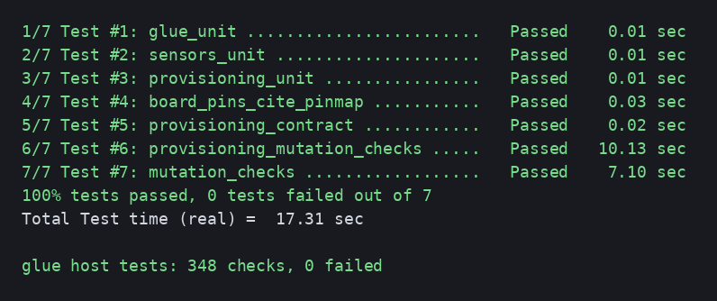

# 4.F2 slice 2: setup glue core tested on a PC; the BLE/Wi-Fi/HTTP part is written but not yet compiled or run

What it shows: ctest output on the host. The new `glue_unit` test (348 checks) proves the in-flight Wi-Fi and HTTP timeouts, the `/device-claim` request body, the HTTP-status-to-reason mapping and the behaviour after setup is closed, next to the earlier suites, all passing.

- Task: 4.F2 slice 2, PR: stacked on https://github.com/nilwerk/nilwerk-lab/pull/66 (link added by the PR body). Persona: Mira (Firmware + Edge AI).
- Agent minutes: see the Agent Log; the Lead's figure wins. Own human-hour estimate: about 10 h.
- Unverified: `nw_prov_idf.c` (NimBLE + `wifi_provisioning` security 2 + Wi-Fi + `esp_http_client`) was written without an ESP-IDF toolchain and has NOT been compiled; the first compile is CI's `firmware` job. Nothing ran on a board. Timeout values (20 s Wi-Fi, 15 s HTTP) and the setup button gesture are proposals. Current figures are estimates.
