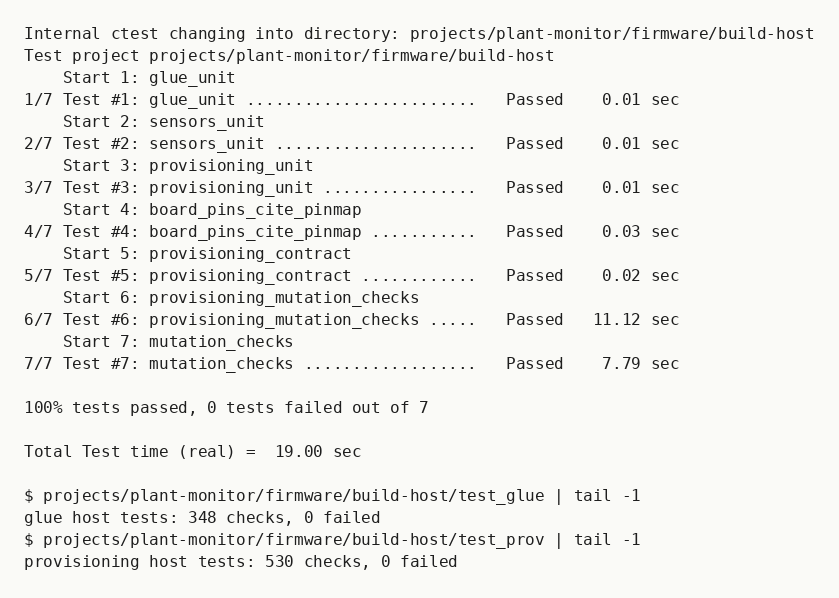

# 4.F2 slice 2 close-out: the BLE glue is in main and compiled by CI; nothing has run on a board

What it shows: the host test run on the merged 4.F2 code (7 of 7 suites, glue 348 checks, provisioning 530 checks, all passing), next to the CI `firmware` job that built the ESP-IDF image for esp32c3 and passed.

- Task: 4.F2 slice 2 (BLE glue). The glue itself was already merged on 2026-11-10 (PR #72, stacked on PR #66). Today's change is the close-out: the WO glue acceptance list and its current table, no new firmware code.
- PR: https://github.com/nilwerk/nilwerk-lab/pull/82 (close-out; the glue itself is PR #72, merged).
- Persona: Mira (Firmware + Edge AI).
- Agent minutes: about 3.3 min (the clock runs from 07:46 CET to 07:49 CET for this session, verification and close-out). The Lead's figure wins. Own human-hour estimate: about 3 h (verify, write the WO table and this item, no hardware).
- Unverified: no hardware run. The ESP-IDF build is checked by CI on commit `c4da8ca` (firmware job, success), not on a board. The setup-mode BLE current is UNVERIFIED and not in the power budget; CLOSED and normal values are estimates from `power-budget.md`. The 20 s Wi-Fi and 15 s HTTP timeouts and the 3 s / 10 s button holds are proposals. The per-unit security-2 salt and verifier in NVS and the real `PLANT_API_BASE_URL` are still missing, so the bench cannot pair a phone yet.
