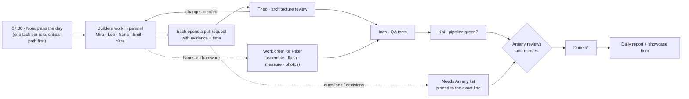
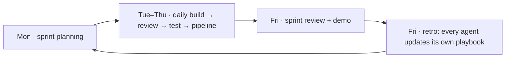

# How the Nilwerk team works

Nilwerk builds connected hardware prototypes with a team of AI agents, led and reviewed by a human
engineer (Arsany) and supported by a human hardware integrator (Peter). This page is safe to share.

## Who is on the team

| Who | Does |
|---|---|
| Nora · Lead / PM | Plans each day, assigns work, reports progress |
| Theo · System Architect | Designs the system, reviews every change against the requirements |
| Ines · QA & Test | Tests every change, passes nothing without evidence |
| Kai · Pipeline / DevOps | Keeps the automated build and checks green |
| Mira · Firmware + Edge AI | Device firmware and on-device machine learning |
| Leo · Full-stack | Mobile app and backend |
| Sana · Cloud AI | AI features in the cloud, with safety rules |
| Emil · PCB designer | Circuit boards, simulated before anything is ordered |
| Yara · 3D designer | Enclosures designed for printing and real use |
| Poppy · PR & Social | Shows the work, with proof |
| Max · Sales | Finds and contacts companies who need prototypes |
| **Arsany** (human) | Owner. Decides, approves, merges every change |
| **Peter** (human) | Assembles, flashes and bench-tests the real hardware |

## One day

## One week (sprint)

## What makes it trustworthy

- **Nothing is "done" without evidence:** architecture approval, QA pass, green pipeline, and a human merge.
- **Every agent measures its time** for every task, so estimates for customers are based on real data.
- **The team learns:** after each sprint every agent turns its lessons into rules in its own playbook.
- **Humans stay in charge** of money, orders, sign-offs and anything that leaves the company.
