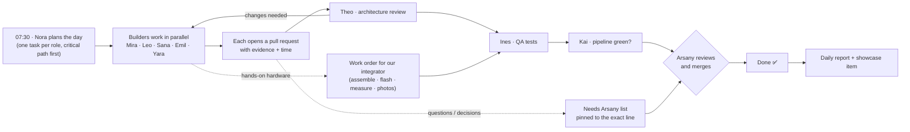
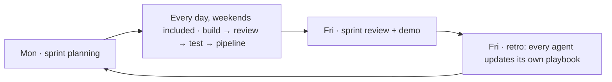

# How the Nilwerk team works

Nilwerk builds connected hardware prototypes with a team of AI agents, led and reviewed by a human
engineer (Arsany) and supported by a human hardware integrator. This page is safe to share.

## Who is on the team

| Who | Does |
|---|---|
| Nora · Lead / PM | Plans each day, assigns work, reports progress |
| Theo · System Architect | Designs the system, reviews every code change against the requirements |
| Ines · QA & Test | Tests every code change, passes nothing without evidence |
| Kai · Pipeline / DevOps | Keeps the automated build and checks green |
| Mira · Firmware + Edge AI | Device firmware and on-device machine learning |
| Leo · Full-stack | Mobile app and backend |
| Sana · Cloud AI | AI features in the cloud, with safety rules |
| Emil · PCB designer | Circuit boards, simulated before anything is ordered |
| Yara · 3D designer | Enclosures designed for printing and real use |
| Poppy · PR & Social | Shows the work, with proof |
| Max · Sales | Finds and contacts companies who need prototypes |
| **Arsany** (human) | Owner. Decides, approves and merges |
| **Hardware integrator** (human) | Assembles, flashes and bench-tests the real hardware |

## One day

## One week (sprint)

## Seven days, parallel builders (as run on 8 Nov 2026)

The team works seven days a week. On Sunday 8 Nov five builders ran in parallel, each for roughly 6 to 16 minutes of agent time (measured), and every result then went through an architect review and a QA test before any human merge. Review comments are first-class output: on that day they caught a wrong pin map, a wrong number in a caption and a misleading baseline comparison (PRs #41, #44, #46, status as of 8 Nov: open, waiting for a human).

## Same-day extra rounds and parallel work without collisions

- When the owner asks for another round on the same day, the lead runs a full extra round (builders, architect, QA, pipeline) and logs the extra hours; the usual limit of one task per role per day is lifted for that day.
- Every agent works in its **own copy of the repository** (a git worktree) and pushes only fast-forward, never forced; before opening a task branch it checks that no other branch for the same task exists. This rule came from a real collision: on 8 Nov two lead sessions produced the same backend task twice.
- Stacked changes state their merge order in the description and are re-targeted to `main` once the parent has merged.

## What makes it trustworthy

- **Nothing is "done" without evidence:** architecture approval, QA pass, green pipeline, and a human merge (documentation-only changes get no architect verdict).
- **Every agent measures its time** for every task, so estimates for customers are based on real data.
- **The team learns:** after each sprint every agent turns its lessons into rules in its own playbook.
- **QA runs the code itself:** on 10 Nov the QA agent re-ran an enclosure check against the newest board and found that part of it could not fail (a typed-in number), see `content/2026-11-10/catches/`.
- **Honest negatives are published:** a missed target (the first edge-AI model) and a check that has not run yet (circuit ERC) are reported as such, never hidden.
- **Humans stay in charge** of money, orders, sign-offs and anything that leaves the company.
